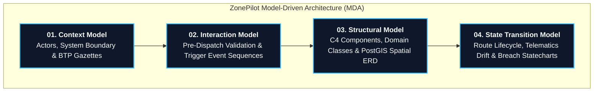
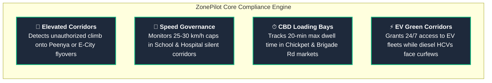

# 🛡 ZonePilot

> **Autonomous Spatial Compliance & Dynamic Fleet Dispatch Engine for Bengaluru**  
> *Preventing urban freight traffic violations, corridor breaches, and loading penalties with real-time PostGIS triggers and pgRouting.*

[](https://spring.io/projects/spring-boot)
[](https://www.postgresql.org/)
[](https://postgis.net/)
[](https://pgrouting.org/)
[](https://react.dev/)
[](#system-architecture-model-driven-architecture)

---

## 🚀 The Real-World Problem

Every day, hundreds of logistics vehicles (e-commerce delivery vans, express cargo, supply chain trucks) operate across Bengaluru. Fleets face harsh municipal traffic penalties:

- **Strict Peak-Hour Freight Curfews:** Heavy Commercial Vehicles (HCV) face blanket bans entering the city during 07:00–11:00 and 16:00–22:00.
- **Flyover & Elevated Corridor Bans:** Bengaluru Traffic Police (BTP) strictly prohibits heavy trucks and 3-wheelers on key flyovers (Peenya, Electronic City Elevated, Hebbal, Silk Board Double-Decker).
- **CBD Loading/Unloading Bay Dwell Limits:** Commercial vehicles stopping in dense markets (Chickpet, Commercial Street, Brigade Road) face heavy fines if dwell times exceed 20 minutes.
- **Sensitive Zone Speed Caps:** School zones and hospital silent corridors enforce rigid speed limits (25–30 km/h) with automatic camera fines.
- **Cost of Failure:** Manual route sheets result in repeated ₹2,000–₹5,000 citations per vehicle, impounded trucks, and missed delivery SLAs.

**ZonePilot solves this with automated spatial intelligence:** validating paths before departure, monitoring real-time GPS pings via atomic database triggers, recalculating detours using 1,000× penalty routing, and granting green corridor exemptions to electric delivery fleets (Tata Ace EV, Euler).

---

## 🏛 System Architecture (Model-Driven Architecture)

ZonePilot's architecture is formalized using **Model-Driven Architecture (MDA)** across 4 distinct modeling viewpoints:



> 📖 **Full Architectural Specifications:**
> - [01. System Context Model & Scope](docs/architecture/01_CONTEXT_MODEL.md)
> - [02. Interaction Model & Sequence Flows](docs/architecture/02_INTERACTION_MODEL.md)
> - [03. Structural Model & PostGIS ERD](docs/architecture/03_STRUCTURAL_MODEL.md)
> - [04. State Transition Model & Statecharts](docs/architecture/04_STATE_TRANSITION_MODEL.md)

---

## 💡 4 Real-World Bengaluru Compliance Pillars



1. **Elevated Corridor Prohibitions:** Automatically routes heavy commercial transport around elevated flyovers, enforcing ground-level arterial passage.
2. **Dynamic Speed Governance:** Real-time comparison between incoming vehicle GPS speed and active speed polygon limits.
3. **CBD Loading Bay Timers:** Geofenced parking session tracking in tight commercial zones; alerts dispatchers at 15 minutes and issues citations at 20 minutes.
4. **Clean Air Priority:** Differentiates vehicle propulsion type (`EV` vs `DIESEL`), ensuring EV delivery vans avoid time-of-day access blocks.

---

## 🖥 Operations Workspace Layout

ZonePilot's frontend is designed for high-stress logistics control rooms with a **Clean 3-Zone Operations Layout**:

```
+-----------------------------------------------------------------------------------------+
|                                    ZONEPILOT OPS HUB                                     |
+---------------------+---------------------------------------------+---------------------+
| 1. FLEET & ALERTS   | 2. LIVE SPATIAL MAP CANVAS                  | 3. DISPATCH & ACTION|
|                     |                                             |                     |
| [Active Fleets (12)]| • Vector Map of Bengaluru                   | • Pre-Dispatch Form |
| • KA01-HCV-0007 (On)| • Elevated Corridors (Purple)               |   - Origin / Dest   |
| • KA01-EV-0002 (OK) | • Speed Zones (Amber 30km/h)                |   - Vehicle Class   |
|                     | • CBD Loading Bays (Cyan)                   | • Instant Validation|
| [Critical Alerts]   | • Active Route Polyline (Green/Red)         | • Reroute Decision  |
| ⚠ Overtime: Chickpet| • Live Vehicle Markers with Azimuth Heading | • Wait-State Action |
| ⚠ Speed: Cotton Schl|                                             | • Telemetry Stream  |
+---------------------+---------------------------------------------+---------------------+
```

---

## ⚡ 4 Showstopper Simulation Scenarios

The integrated simulation engine features 4 pre-calibrated Bengaluru scenarios demonstrating the engine's core capabilities:

1. **Scenario 1 — Diesel HCV Flyover Diversion:** A diesel heavy truck traveling between Electronic City and Silk Board is dynamically barred from entering the elevated expressway and diverted to Hosur Road surface transit.
2. **Scenario 2 — Tata Ace EV Green Corridor Transit:** An electric delivery van navigating central Bengaluru during peak curfew hours (08:30 AM) is granted full passage through restricted central zones.
3. **Scenario 3 — School Zone Speed Alert:** A parcel delivery van passing through Residency Road near Bishop Cotton School is detected traveling at 48 km/h in a 25 km/h school zone, triggering an instant speed compliance breach.
4. **Scenario 4 — Chickpet Loading Bay Overtime:** A commercial freight vehicle staged at Chickpet loading bay is tracked across a 25-minute dwell session, triggering a 15-minute amber warning followed by an automatic citation at 20 minutes.

---

## 🛠 Quick Start Guide

### Prerequisites
- Java 25 (Temurin) or Java 17+
- Node.js 18+ & npm
- PostgreSQL 16 with PostGIS 3.4 & pgRouting 3.x
- Docker (optional, for running with containers)

### 1. Database Setup
Ensure PostgreSQL is running with PostGIS and pgRouting extensions enabled:
```sql
CREATE DATABASE zonepilot;
\c zonepilot
CREATE EXTENSION postgis;
CREATE EXTENSION pgrouting;
```

### 2. Start the Backend
```bash
cd backend
mvn clean spring-boot:run -Dspring-boot.run.profiles=dev
```
*API will start on `http://localhost:8080`. Swagger documentation available at `/swagger-ui.html`.*

### 3. Start the Frontend
```bash
cd frontend
npm install
npm run dev
```
*Access the Operations Control Workspace at `http://localhost:5173`.*

---

## 📚 Documentation — start here

| Doc | What it answers |
|---|---|
| [10 — Platform-Independent Requirements (PIM)](docs/10-PIM-PLATFORM-INDEPENDENT.md) | Scope, actors, FR/BR, UML — the stable contract |
| [20 — Telemetry, Roadmap & Production Plan](docs/20-TELEMETRY-AND-ROADMAP-PLAN.md) | MQTT/STOMP pipeline, auth-first slices, scaling, pre-build gates |
| [25 — Data Models, ER & Pipelines](docs/25-DATA-MODELS-AND-PIPELINE.md) | Table specs V21–V26, ER diagram, pipeline sequences, config |
| [30 — Demo Hosting & UX Plan](docs/30-DEMO-HOSTING-UX-PLAN.md) | How to run/host the demo, tester script, UI flows, perf budget |
| [MDA architecture suite](docs/architecture/README.md) | Context / interaction / structural / state models |

> Stale QA snapshots live in [docs/archive/](docs/archive/) for history — not current spec.
> Map data © [OpenStreetMap](https://www.openstreetmap.org/copyright) contributors (ODbL).
