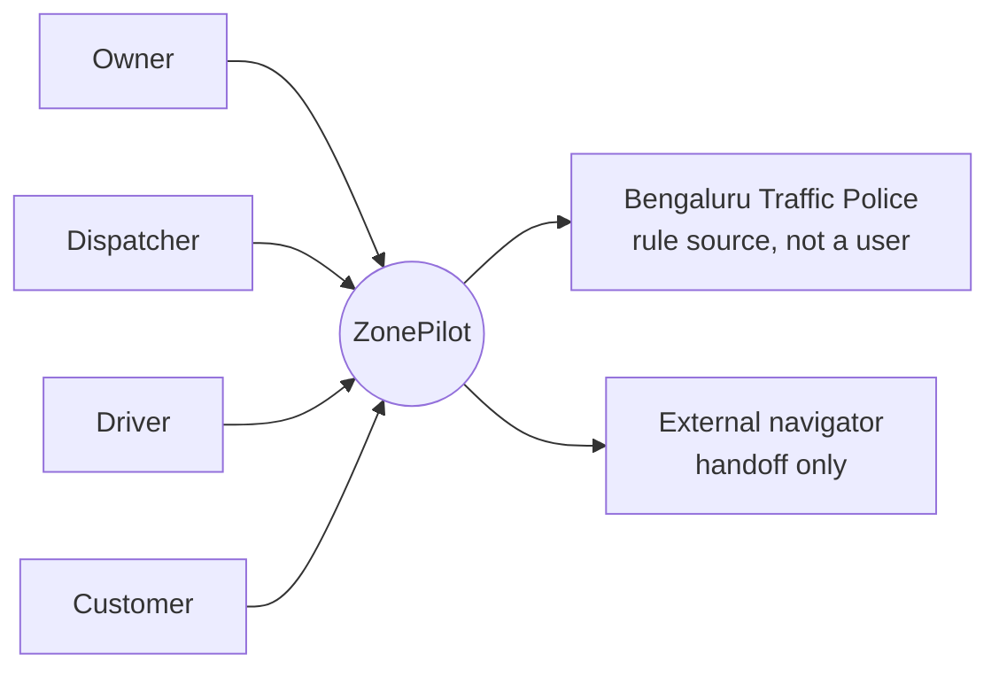
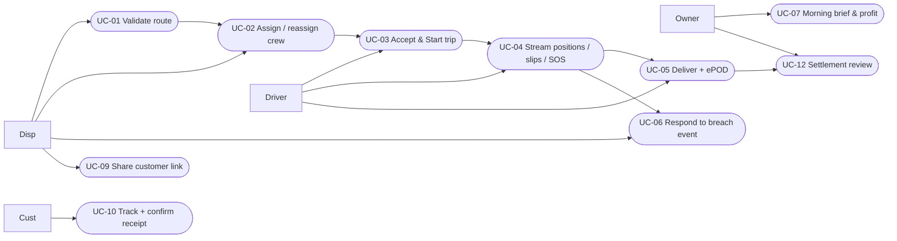
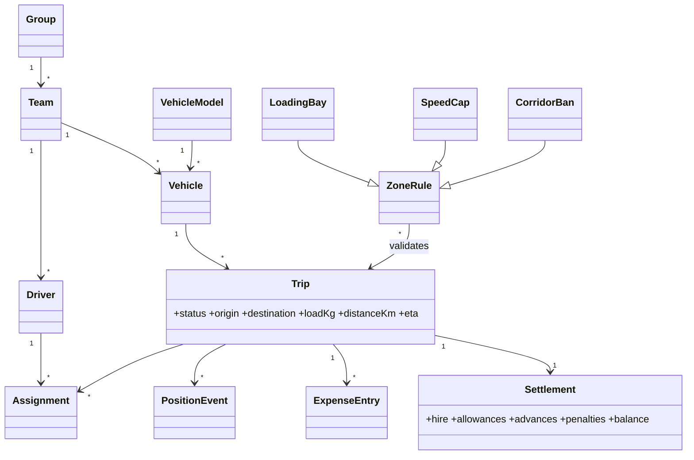
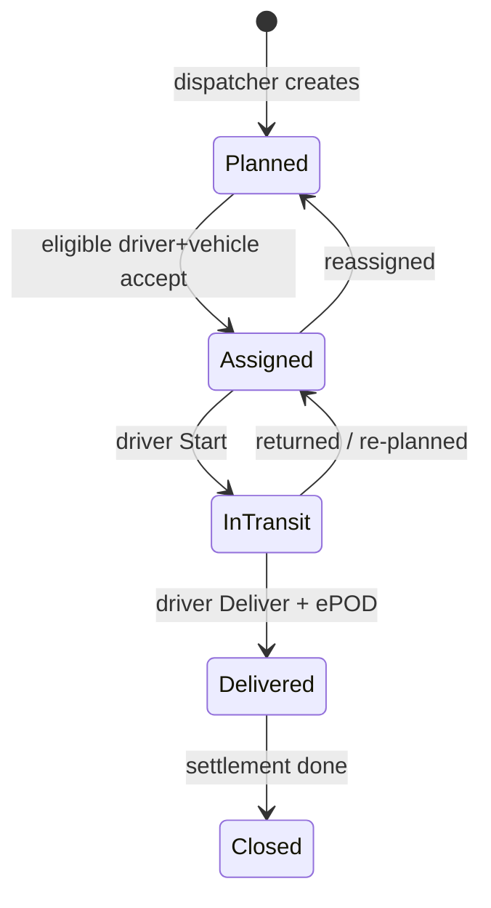
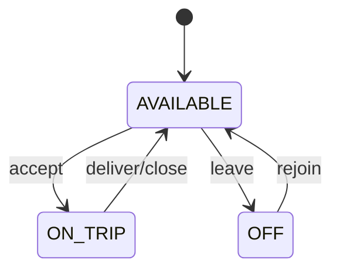
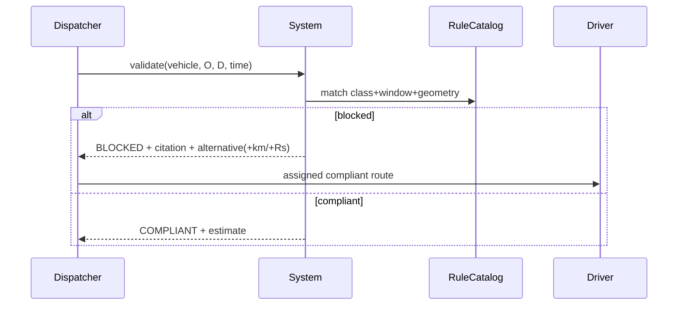
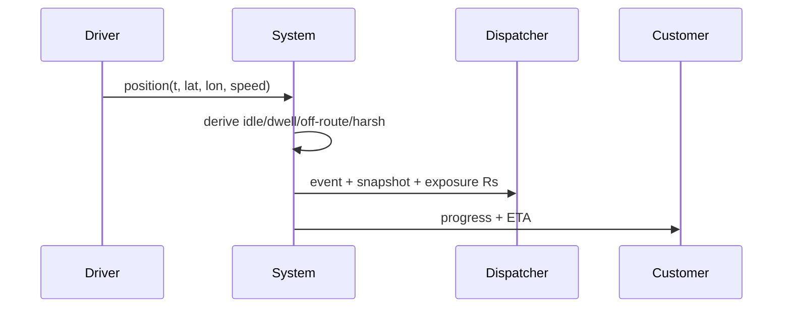
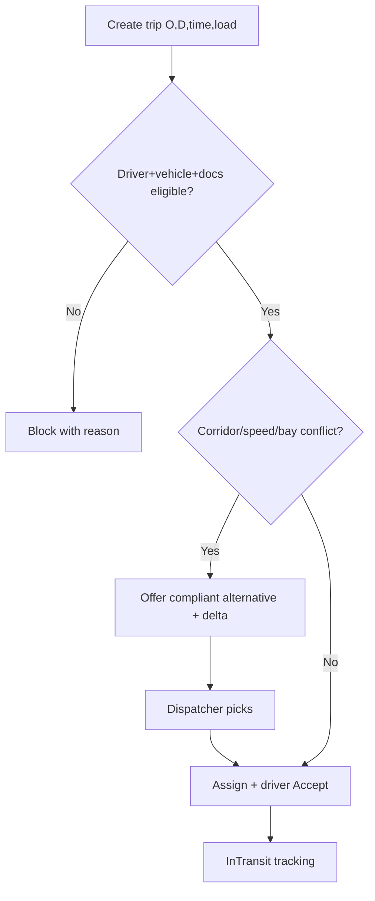
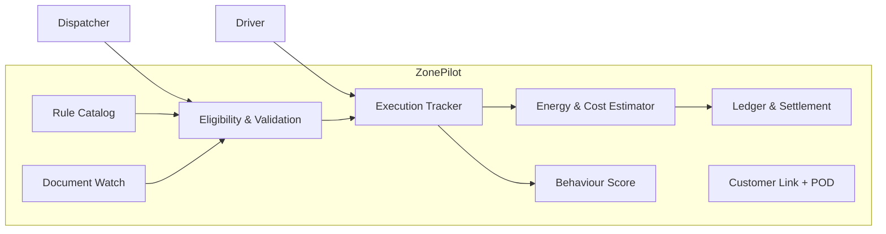
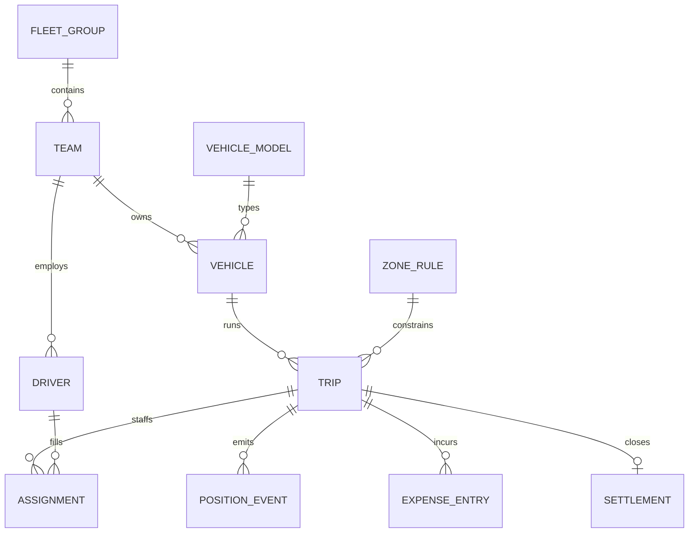

# ZonePilot — Platform-Independent Model (PIM) & Requirements

> Amendment 2026-11-01 (Wave C): depots removed (V33) — all scoping is by flat fleet group (`fleet_group`, STOMP `/topic/group/{id}`). Earlier "depot" wording below now reads "group"; history kept in git.

> Method: OMG MDA (CIM → PIM → PSM) + IEEE/ISO/IEC 29148 SRS structure + UML 2.x + C4/arc42 views.
> Status: PIM — no platform names constrain these requirements. Existing `docs/architecture/01-04` stay as early PSM sketches; this file is the stable contract they must satisfy.
> Sources: OMG MDA Guide 2.0 (PIM stable as tech churns); 29148 §9.6 SRS sections; C4+arc42 mapping (Context→arc42-3, Container→5/L1, Component→5/L2, Dynamic→6, Deployment→7).

## 1. Identification & revision

| Item | Value |
|---|---|
| System | ZonePilot — small-fleet (5–50 trucks) compliance + dispatch + money loop, Bengaluru first |
| This doc | PIM v1.0, 2026-10-24 |
| Owner | Product (requirements), Fleet-owner reviewers (acceptance) |
| Change log | v1.0 initial PIM; PSM/NFR/tech-stack deferred to §12 |

## 2. Purpose & scope (CIM summary)

**Problem:** a dispatcher sends a truck into a city whose rules change by road, vehicle class, and hour; the fine (Rs1,000–2,000) lands after the trip, plus fuel is stolen by idle/detour and drivers churn for lack of transparent pay.
**Scope IN:** zone-rule catalog with legal provenance; pre-dispatch eligibility gate (block + compliant alternative); trip execution tracking (positions → speed/idle/dwell/off-route events); energy & cost estimates with transparent formulas; driver advances/settlement ledger; document-expiry wall; behaviour scorecards; customer tracking + proof-of-delivery.
**Scope OUT (v1):** turn-by-turn navigation engine (hand off to external navigator); payroll tax filing; OCR auto-extract; OBD hardware; multi-city rule packs beyond Bengaluru seed.

## 3. Actors & stakeholders (CIM)

| Actor | Goal | Needs from system |
|---|---|---|
| Owner (5–50 trucks) | profit/truck, zero fines | morning brief, cost/km, settlement calm, doc wall |
| Dispatcher | clean dispatch day | board, eligibility gate, reassign history, ETA link |
| Driver | pay clarity, simple day | trip card (Kannada/Hindi), 4 buttons, advance visibility, SOS |
| Customer | know where goods are | tracking link, ETA, ePOD |
| BTP / RTO (sources) | enforce | cited sections, timings, fines — system never invents rules |

## 3A. Use cases & how each actor interacts (interaction model)

| Actor | Device | Touchpoints (in order) | System answers back |
|---|---|---|---|
| Dispatcher (desktop) | ops board | brief → unassigned queue → validate → assign → live exceptions → close | BLOCKED+citation+alternative, ETA, exposure Rs |
| Driver (phone, Kannada/Hindi) | trip card | Accept → Start → navigate handoff → slips/SOS → Deliver+ePOD | one route, advance balance, plain-language blocks |
| Owner (phone/desktop) | brief + ledger | profit/truck, settlement review, doc wall | cost/km, score, expiry alerts |
| Customer (link, no login) | tracking page | ETA → receipt confirm | progress + ePOD copy only |

UC pre/post (short): UC-01 pre: trip draft + eligible crew; post: COMPLIANT or BLOCKED+citation. UC-02 pre: validated route; post: assignment + history row. UC-04 pre: active trip; post: events + ETA. UC-05 pre: at destination; post: Delivered, billing-ready. UC-12 pre: ePOD; post: Closed, balance zero or reason.

## 4. Functional requirements (numbered, testable)

### F1 Fleet & vehicle models
- FR-01: register vehicle with registration no (unique), class (HCV/MMV/LCV/3W-goods), fuel (DIESEL/CNG/EV), model ref, group, active flag.
- FR-02: maintain vehicle-model catalog: payload_kg, consumption (km/L or kWh/km), energy price defaults, max speed; seed Tata Ace EV1000 (21.3kWh/161km/1000kg), Euler HiLoad (12.4kWh/170km/688kg), diesel LCV 8km/L, HCV 4km/L.
- FR-03: block dispatch of inactive or already-on-trip vehicle.

### F2 Crew organisation (no big mess)
- FR-10: groups contain teams; each vehicle has one primary + optional relief driver per shift.
- FR-11: driver record: name, phone, licence class + expiry, docs, salary mode (per-trip/monthly), status (AVAILABLE/ON_TRIP/OFF).
- FR-12: roster view filters by group + status + doc-validity; expired licence/doc blocks assignment with reason.
- FR-13: attendance auto-marks from first on-duty action; relief assignment keeps history (who, when, why).

### F3 Zone & rule catalog (provenance, not mocks)
- FR-20: each rule: geometry, vehicle-class list, time windows, legal section, fine Rs, source URL, effective-from.
- FR-21 (seed, Sep-2025 BTP release): BGS flyover HCV 24h / others 07–11+16–22; Peenya pax/3W-goods 24h, HMV/MMV peak; Silk Board double-decker HCV 24h; Airport Rd 2W/auto 24h, goods 06–22; E-City goods pattern from Sep-11.
- FR-22: speed caps: cars 60, trucks/buses 50, 3W 40, tractor 20 (btp.gov.in/spotfines), school 25 / hospital 30 overlays.
- FR-23: loading bays with dwell caps (Chickpet 20min etc.); stale rules (past review date) show warning, never silently enforced.

### F4 Pre-dispatch gate (block + alternative)
- FR-30: validate(vehicle, origin, destination, departure time) → COMPLIANT or BLOCKED with cited rule + fine exposure.
- FR-31: on BLOCKED, offer compliant alternative with +km/+min/+Rs delta; dispatcher picks, driver gets single route.
- FR-32: ineligible driver/vehicle/doc state blocks with plain-language reason before route is shown.

### F5 Execution tracking
- FR-40: ingest timestamped positions (any source: phone, file replay, simulator) → derive speed, idle (>5min <3km/h), dwell in bays, off-route deviation, harsh brake/accel, sharp turn.
- FR-41: raise events with rule citation + map snapshot; never auto-fine — system estimates exposure.
- FR-42: customer link shows progress + ETA without exposing crew pay internals.

### F6 Energy, load & money
- FR-50: estimate per trip: distance, fuel/kWh = dist × base × (1+0.4×load_ratio) + idle allowance (diesel 2L/h, EV 1kW); cost with editable prices; overload flag when load > payload.
- FR-51: ledger: advance given vs slips (fuel/toll) vs settlement = hire + allowances − advances − penalties; every line tied to trip.
- FR-52: views: cost/km, profit/trip, profit/truck/month; formula shown on screen; actual fills calibrate estimates.

### F7 Documents, score, POD
- FR-60: 12+ driver docs + vehicle fitness/permit/insurance/PUC with 30/15/7/1-day alerts.
- FR-61: behaviour score 100 − weighted events/100km (overspeed, harsh, idle, on-time, no-show, complaints); label ECO/NORMAL/AGGRESSIVE with Rs impact.
- FR-62: ePOD photo/signature closes trip → triggers billing state.

## 5. Business rules (with sources)

| ID | Rule | Source |
|---|---|---|
| BR-01 | Fine Rs1,000–2,000 goods-on-flyover / speeding | MV Sec 177A/183, trafficchallan fines feed |
| BR-02 | Corridor timings §4/FR-21 | BTP Aug-30-2025 release (IE/DH/CNBC), CCTV enforced |
| BR-03 | Speed caps §4/FR-22 | btp.gov.in/spotfines, MV Sec 112 |
| BR-04 | Overload must off-load at own cost | Karnataka MV Rules / RTO weighment powers |
| BR-05 | Estimates are estimates | shown formula + calibration; never presented as metered fuel |

## 6. Domain model (PIM class diagram)

## 7. Lifecycles (state machines)

Document: VALID → EXPIRING(<30d) → EXPIRED (blocks assignment).

## 8. Key flows (sequences)

Settlement: `balance = hire + allowances − advances − slip spend − penalties`; negative blocks Close with reason.

## 9. Pre-dispatch activity (gate)

## 10. PIM components (C4, platform-free)

## 11. Logical data (retention/access)

Trip + positions 13 months (dispute window); docs until superseded + 1y; ledger 7y (GST); driver sees own wallet only; customer sees trip progress only; owner/dispatcher see group scope.

## 11A. Logical ER (structural, platform-free)

## 11B. Component interfaces (what each exposes, PIM-level)

| Component | Provides | Requires | Calls |
|---|---|---|---|
| Rule Catalog | matchRule(vehicle, place, time) | seeded rules + provenance | — |
| Gate | validate() → COMPLIANT/BLOCKED+alternative | Catalog, Docs, Roster | Tracker |
| Tracker | ingest(position) → events + ETA | active Trip | Estimator, Score, Link |
| Estimator | energy/cost + delta | Trip + Model + prices | Ledger |
| Ledger | advance/settle/close | Estimator, ePOD | — |
| Doc Watch | validity + alerts | docs + calendar | Gate |
| Score | score + label + Rs impact | Tracker events | — |

## 11C. Traceability (FR → UC → verification)

FR-30/31→UC-01→blocked-demo; FR-03/FR-11..13→UC-02→ineligible-block test; FR-40/41→UC-04/06→replay determinism; FR-50..52→UC-12→hand-calc ±5%; FR-60→Gate→expiry block; FR-62→UC-05→no-Close-without-ePOD.

## 12. Deferred to PSM/NFR (explicitly NOT decided here)

Runtime (containers/workers), DB/engine choice, map SDK (Leaflet/MapLibre/Google), auth, offline sync protocol, OCR, telematics hardware, multi-city packs, SLOs. Next step: NFR + PSM mapping table (PIM element → tech choice → why).

## 13. Verification per requirement

Each FR maps to acceptance: FR-30/31 demo blocked E-City diesel 09:30 + alternative delta; FR-40 replay file yields identical events; FR-50 hand-computed formula match ±5%; FR-12 expired licence blocks with reason; FR-62 no Close without ePOD.

## 14. Glossary

Curfew window, dwell, green corridor, load ratio, ePOD, settlement, relief driver, exposure (Rs at risk, not a fine).
