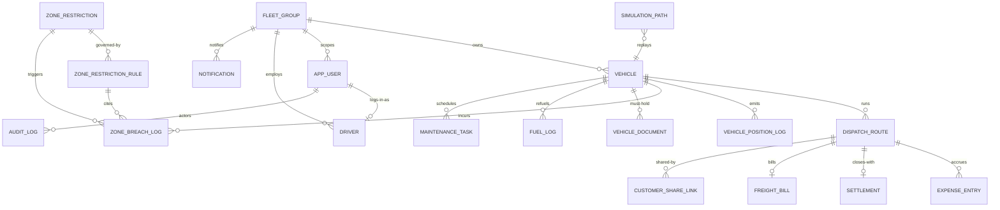
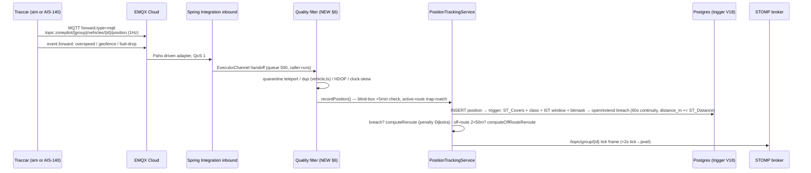

# ZonePilot — Data Models, ER, Pipelines & Configuration

> Amendment 2026-11-01 (Wave C): depots removed (V33) — scoping by `fleet_group`; `simulation_path` retired (V43, table + GIST index dropped) — replay is served from stored fixes via `ReplayService`. Earlier "depot" wording below now reads "group"; history kept in git.

> PSM companion to `10-PIM` (requirements) and `20-TELEMETRY` (slices/infra). Every statement here is traceable to `backend/src/main/resources/db/migration/V*.sql` or `.../service/*.java`. Tags: **EXISTS** (shipped, V1–V20) vs **NEW** (slice that creates it).

## 1. Table inventory

| Table | State | Purpose |
|---|---|---|
| `group` | EXISTS V1 | Fleet home base; all scoping hangs off this |
| `vehicle` | EXISTS V1 + V14 (`active_dispatch_route_id`) + NEW cols (Slice 4) | Trucks; needs `propulsion`, `odometer_km` |
| `zone_restriction` | EXISTS V1 | Polygon + type (NO_ENTRY / TIME_RESTRICTED / VEHICLE_CLASS_RESTRICTED) |
| `zone_restriction_rule` | EXISTS V1 + V20 (null-class heal) | Class + time window + day bitmask per zone |
| `dispatch_route` | EXISTS V1 + V13 (cost/time) + V15 (WAIT) + NEW cols (Slice 4) | Trip: validation → dispatch → settle |
| `vehicle_position_log` | EXISTS V1, monthly partitions | 1Hz ticks; trigger-evaluated; needs dedupe key |
| `zone_breach_log` | EXISTS V1 + V18 (stateful: `end_time`, `distance_m`) | Open breach per vehicle+zone, extended per tick |
| `simulation_path` | RETIRED V43 (dropped with GIST index) | Was: scenario waypoints + step cursor; replay now served from stored fixes via ReplayService |
| `blr_2po_4pgr` | EXISTS (osm2pgrouting import) | Bengaluru road graph for `pgr_dijkstra` |
| `app_user` | NEW Slice 1 | Login + role + group scope |
| `driver` | NEW Slice 2 | Licence, shift, wallet link |
| `vehicle_document` | NEW Slice 2 | FITNESS/PERMIT/INSURANCE/PUC expiries |
| `fuel_log` / `expense_entry` / `settlement` | NEW Slice 4/7 | Money loop |
| `maintenance_task` | NEW Slice 5 | km/date triggers, workshop gate |
| `customer_share_link` / `freight_bill` | NEW Slice 6/7 | ePOD + billing |
| `notification` / `audit_log` | NEW Slice 8/9 | Pings + who-changed-what |

Views (EXISTS V8): `v_active_vehicle_positions`, `v_vehicle_breach_summary`, `v_zone_violation_stats`, `v_currently_active_restrictions`. Indexes (EXISTS V9): GIST on all geometry + btree on vehicle/time/status keys.

## 2. ER diagram (current + new)

## 3. New/changed column specs (migration order)

- **V21 partitions:** monthly `vehicle_position_log_YYYY_MM` through 2027 + cron that always keeps +3 months ahead; drop raw partitions >90d (aggregates + pinned challan evidence survive). Partitions currently end 2025-06 + DEFAULT — this is overdue.
- **V22 auth:** `app_user(id, group_id→group NULL for OWNER, name, phone UNIQUE, password_hash, role ENUM OWNER/DISPATCHER/DRIVER, is_active, created_at)`; dedupe `UNIQUE(vehicle_id, recorded_at)` on position log (partition key included, legal).
- **V23 crew/docs:** `driver(id, group_id→group, user_id→app_user NULL, name, licence_no UNIQUE, licence_expiry, phone, salary_mode, is_active)`; `vehicle_document(id, vehicle_id→vehicle CASCADE, type ENUM FITNESS/PERMIT/INSURANCE/PUC, doc_no, expiry_date, created_at)` + index on `expiry_date`.
- **V24 trip money + propulsion:** `vehicle` += `propulsion ENUM EV/DIESEL/CNG DEFAULT DIESEL`, `odometer_km`; `dispatch_route` += `distance_km, eta_min, revenue_rs, fuel_est_l`; `fuel_log(id, vehicle_id, filled_at, litres, amount_rs, odometer_km, station, created_by)`; `expense_entry(id, dispatch_route_id NULL, vehicle_id, category ENUM FUEL/TOLL/FOOD/REPAIR/ADVANCE/OTHER, amount_rs, occurred_at, receipt_url, created_by)`; `settlement(id, dispatch_route_id UNIQUE, hire_rs, allowances_rs, advances_rs, penalties_rs, net_rs, settled_at)`.
- **V25 maintenance:** `maintenance_task(id, vehicle_id, type, due_km, due_date, status ENUM DUE/IN_WORKSHOP/DONE, closed_at)`; vehicle in WORKSHOP blocks dispatch gate.
- **V26 share/bill/notify/audit:** `customer_share_link(id, dispatch_route_id, token UNIQUE, expires_at, created_by)`; `freight_bill(id, dispatch_route_id UNIQUE, amount_rs, status, raised_at, paid_at)`; `notification(id, group_id, user_id NULL, channel, payload TEXT, status, created_at)`; `audit_log(id, actor_id→app_user, action, entity, entity_id, diff JSONB, created_at)`.

## 4. Pipeline execution

### 4a. Live ingest → tracking → breach → broadcast (Slice 3 target)

Map-match rules (EXISTS, `PositionTrackingService:164`): ≤30m on-route (heading flip >150° = carriageway glitch → snap); 30–50m tolerate; >50m twice consecutively = off-route reroute; no active route = pass-through. State lives in `ConcurrentHashMap`s today — **must move to Redis in Slice 3** (lost on restart, breaks with 2 instances).

### 4b. Pre-dispatch validation (EXISTS, extended Slice 2)

`nearest road node (origin, dest)` → `pgr_dijkstra` on `blr_2po_4pgr` → edge-direction-aware LineString assembly (EXISTS `RoutingService:77`, fixes off-road jumps) → `sp_validate_route` (ST_Intersects + class + window) → COMPLIANT stored, or NON_COMPLIANT + 1000×-penalty detour (5 attempts) → WAIT option holds departure (V15). Slow path runs async with a semaphore sized to PG cores (plan §4).

### 4c. Simulation tick (EXISTS → Slice 3 retires live use, keeps demo replay)

`tick()`: next waypoint per active path → heading via atan2 → deviation injector (10% ~50m glitch + 180° flip, 5% wrong-turn ×3 ticks) → `recordPosition(SIMULATED)` → response MOVING/COMPLETED. Traccar replaces the injector with real protocol behavior; `simulation_path` + `startFromRoute()` remain as the one-click "Play morning shift" demo.
> Retired V43 (2026-11-01): table + GIST index dropped; ReplayService replays stored fixes instead.

## 5. Supporting configuration

- **Traccar (`traccar.xml`):** `forward.enable=true, forward.url=<emqx-host:1883>, forward.type=mqtt, forward.topic=zonepilot/{group}/vehicles/{id}/position`, `forward.retry.*` on; mirror set under `event.forward.*`. Capture one position + one event JSON as fixtures.
- **Backend (`application.yml`):** `mqtt.url/username/password` (env), `spring.threads.virtual.enabled=true`, validation `Semaphore` bean, `@Async("broadcastExecutor")`, Caffeine `zoneRules` cache, Redis `gps:latest:*` GEO + route cache, Bucket4j buckets on auth/ingest/links, `MaxRAMPercentage=75`.
- **DB ops:** monthly partition cron (+3 ahead, drop >90d raw), `VACUUM ANALYZE` after OSM import, `statement_timeout` on report role, Fly volume snapshots daily + one restore drill before testers.
- **Frontend:** route-lazy pages, lazy LiveMap + fixed placeholder, ~~`leaflet-trackplayer` with explicit `speed` + `src/types/leaflet-trackplayer.d.ts` shim~~ SUPERSEDED 2026-11-01 (server-driven replay via `POST /api/replays`, no TrackPlayer dep), Carto tiles + markercluster at 50+, OSM attribution.

## 6. Brutal notes (do not skip)

1. Trigger-per-insert is demo-grade: at 50 trucks/1Hz the V18 function (zone scan + breach lookup + distance calc per row) becomes the write bottleneck — async consumer at Slice 3, trigger stays as safety net.
2. `zone_breach_log.position_log_id` has no FK (partitioned target) — enforce via the dedupe key + app query, document it.
3. Partitions end 2025-06: V21 is urgent even before Slice 1, else everything lands in DEFAULT.
4. Bengaluru bbox is hardcoded (`PositionTrackingService:36`); multi-city needs it per-group.
5. `sp_validate_route` uses server time — TZ pinned IST in V16/V17; keep every new time path on `recorded_at` (timestamptz), never `NOW()`-local.
