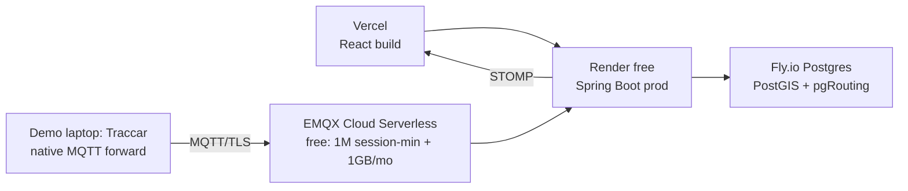

# ZonePilot — Demo Hosting + UX Plan

> Companion to `10-PIM` (what/why, stable) and `20-TELEMETRY-AND-ROADMAP` (backend pipeline + slices).
> Rule: PIM never names tools; this file never re-argues requirements. This file changes fastest.

## 0. Plan-file map (why three, not one)

| File | Job | Changes |
|---|---|---|
| `10-PIM` | Platform-free requirements, actors, FR/BR, UML | Rarely — only when scope changes |
| `20-TELEMETRY…` | PSM backend: MQTT/STOMP, auth, concurrency, slices, pre-build gates | Per slice |
| `30-DEMO-HOSTING-UX` (this) | How anyone runs, tries, and feels the product | Often — hosting tiers, demo script, UI |

## 1. Demo hosting topology (near-zero cost)

| Service | Where | Why |
|---|---|---|
| Frontend | Vercel (already) | Free, edge-cached |
| Backend | Render free 512MB | Single instance fine for demo; virtual threads raise headroom |
| DB | Fly.io PG (already) | Verify PITR before inviting testers |
| MQTT | EMQX Cloud Serverless, not self-hosted | Free quota covers demo 100×; no broker ops; TLS built-in |
| Traccar (native MQTT forward) | Demo laptop, never Render free | Traccar wants ~512MB+ alone; `forward.type=mqtt` publishes to EMQX Cloud, backend consumes — same code path as production, no bridge |
| `sim/` replay script | In repo, paho-mqtt, same topic/payload schema | Testers without Traccar run one command and get identical traffic |

Render free sleeps: warm it (`/actuator/health`) before a demo call; note the 30s cold start in the script.

## 2. Tester experience — guided 6-minute script

Seed a `demo` group (4 vehicles, 4 scenarios prewired). Landing = operation brief, not a blank map:

1. **Act 1 — Block (90s):** dispatcher validates Silk Board→E-City diesel HCV at 09:30 → red banner cites E-City elevated 06–22 + fine → one-click compliant detour. Tester learns the wedge.
2. **Act 2 — Live (2min):** "Play morning shift" replays all four scenarios as STOMP ticks with replay trails; Chickpet dwell goes amber 15:00 → cited 20:00 live.
3. **Act 3 — Money (2min):** challan ledger totals the shift (fines avoided vs incurred), fuel estimate per trip, month P&L sketch.
4. Debrief prompt: "Which of your routes would this have blocked last week?" — the question that sells.

One-click replay matters more than any feature: no tester runs Traccar.

## 3. UX — roles, hierarchy, flows

One hero question per role, answered in <3s without scrolling (Volpis/Lokomax pattern):

| Role | Hero | Pattern |
|---|---|---|
| Dispatcher | What needs my attention? | Exception inbox → live map → assign |
| Driver | How did I drive today? | Score + trend + last trip |
| Owner | Are we making money? | 5–6 KPIs + drill-down by group |

- **3-tier display:** hero tile (1) → context (3–5) → drill-down one tap away. Red = incident, amber = warning, green = healthy — never decorative. KPIs carry 7/30-day sparklines, not bare numbers.
- **Dispatch flow (state machine, mirrors PIM §7):** Unassigned queue → eligibility gate (licence/docs/on-trip) → Assign → driver Accept → In-Transit (live) → ePOD → Settled. Reassignment keeps history. Every screen shows the trip's current state; no dead-end pages.
- **Exception-first:** breaches, doc-expiry, delays surface as a triage inbox with signal→evidence→action in one pane (no tab-hopping between Breaches/Reports/Vehicles).
- **Driver PWA:** 4 actions max per screen, Hindi/Kannada labels, works one-handed; offline queue with visible "3 pending sync".

## 4. Performance budget (production feel)

Current `router.jsx` eagerly imports all 7 pages + LiveMap loads Leaflet synchronously — fix in Slice 2/3:

- Route-based `React.lazy` + `Suspense` per page (map, charts load only on visit).
- LiveMap lazy with fixed-height placeholder (prevents CLS jump; soft background + "loading map").
- Skeleton cards for KPI tiles and tables (never blank white or spinner-only).
- Tiles: Carto light for ops clarity; tile CDN + `loading:lazy` prioritizes viewport; marker clustering at 50+ trucks (supercluster via `Leaflet.markercluster`).
- Targets: LCP <2.5s on 4G, CLS ≈ 0, route change <300ms, tick→pixel <2s. Measure with Web Vitals + Lighthouse CI in the new GitHub Action.
- OSM attribution badge in map corner (ODbL requirement).

## 5. User journey traces (build UI against these)

**Dispatcher morning (6:40):** login → brief (trucks out/idle/workshop, docs expiring 7d) → unassigned queue → gate-check assign → shift plays live → delay ping → evening settle. **Driver trip:** Accept → Start (duty gate opens tracking) → Maps handoff → slip photo → Deliver + ePOD (duty gate closes). **Owner Sunday:** week P&L → cost/km by vehicle → worst driver score → doc wall.
