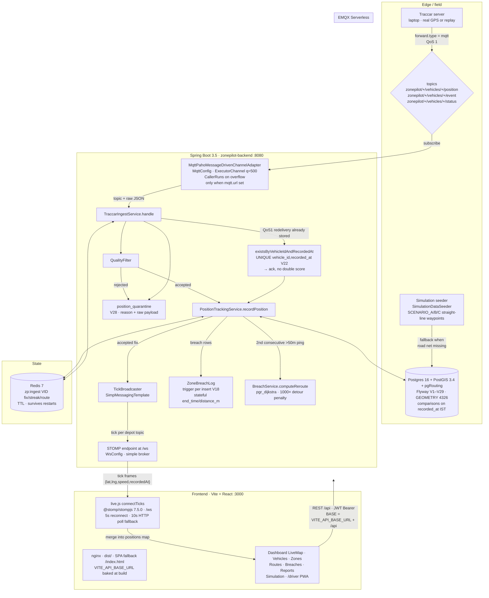
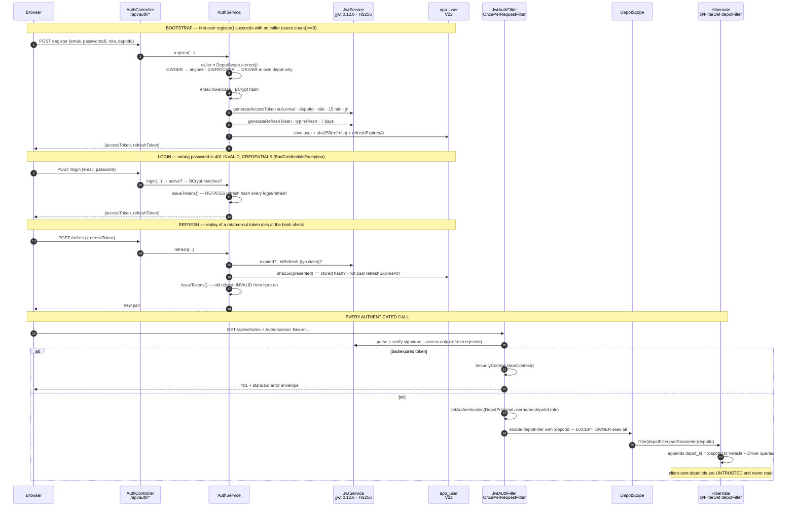
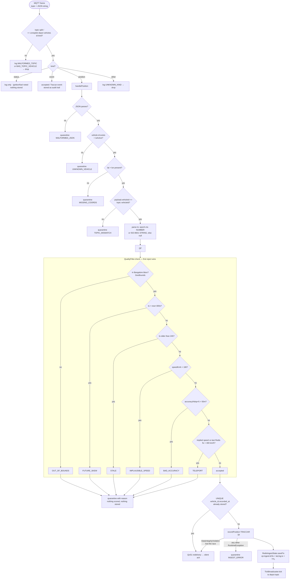
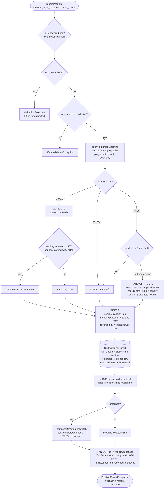
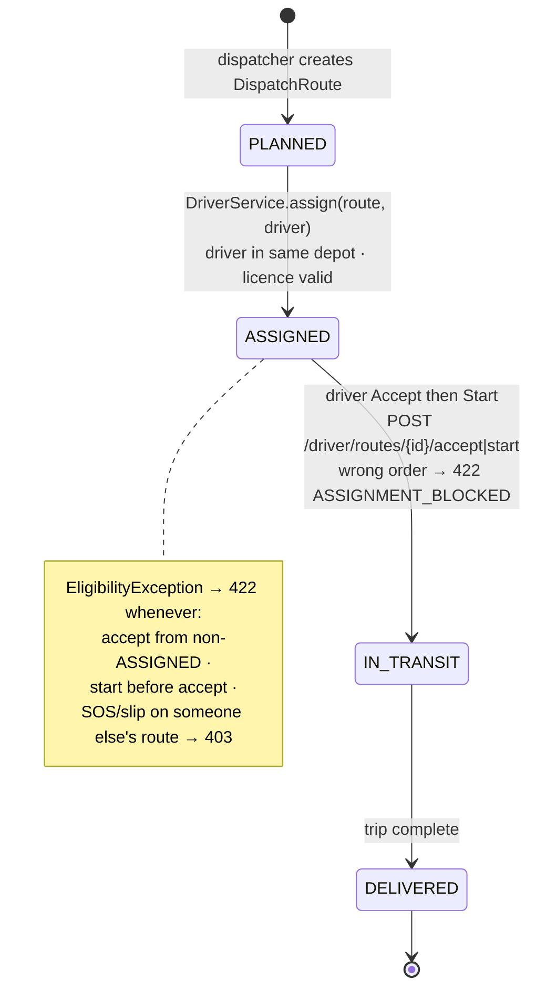
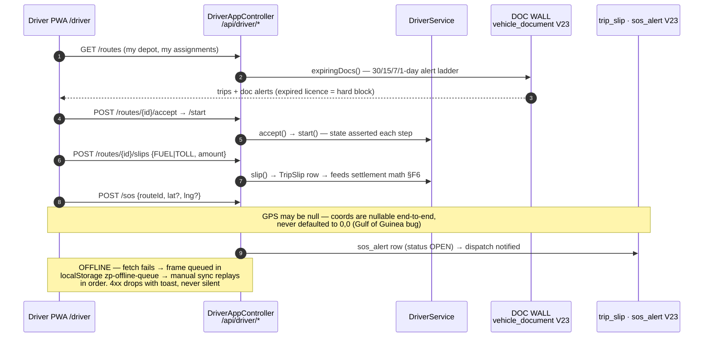
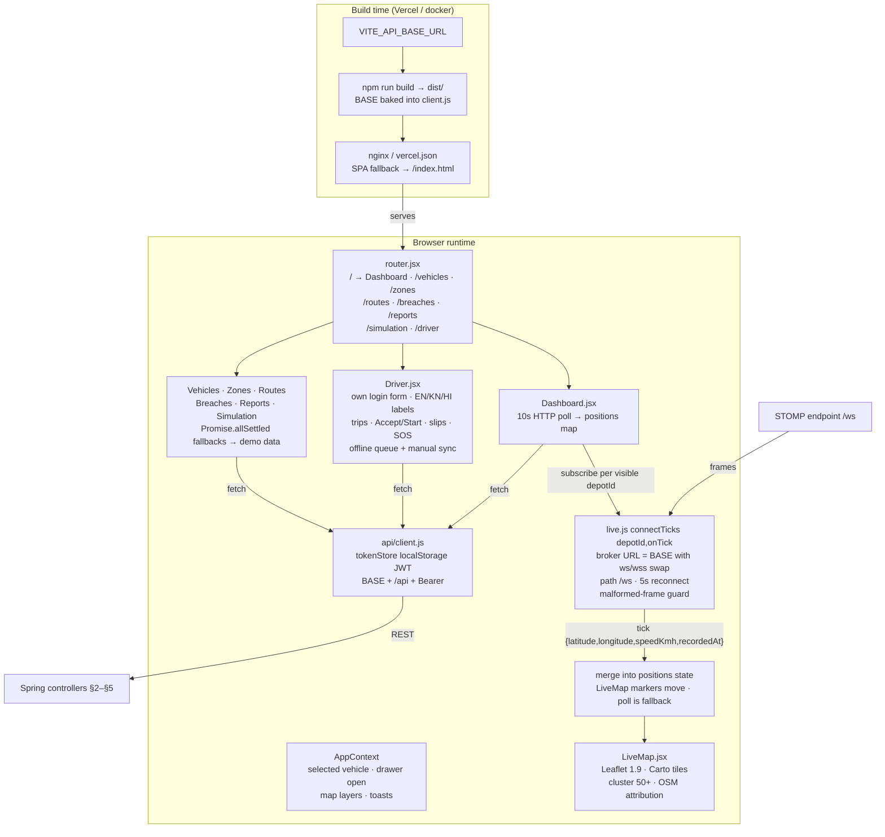
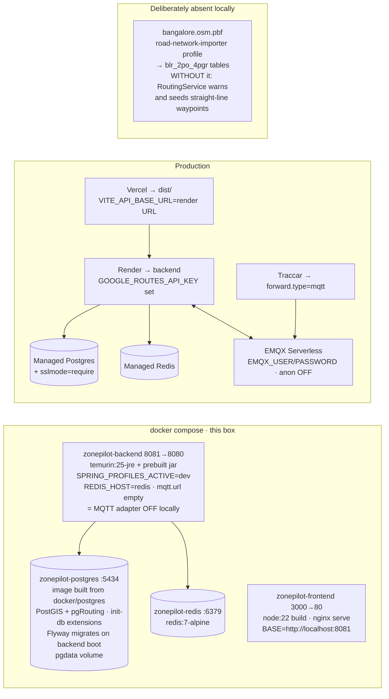

# ZonePilot — End-to-End Data Flow & Component Internals

> How every piece moves data, what happens *inside* each component, and how they
> connect. Diagrams are Mermaid; code refs are `backend/...` and `frontend/...`.
> Naming convention follows the existing docs (`10-`, `20-`, `25-`, `30-`, `40-`).

---

## 1. System overview — who talks to whom

**Connection cheat-sheet**

| From → To | Protocol | Addr (local docker) | Addr (prod) |
|---|---|---|---|
| Traccar → EMQX | MQTT QoS1 | EMQX Cloud | EMQX Serverless |
| Backend → EMQX | MQTT subscribe | `mqtt.url` empty = adapter off | `mqtt.url` + `EMQX_USER/PASSWORD` |
| Browser → Backend REST | HTTPS + Bearer | `http://localhost:8081/api` | `VITE_API_BASE_URL` |
| Browser → Backend ticks | STOMP over WS | `ws://localhost:8081/ws` | derived from `VITE_API_BASE_URL` (ws-swap) |
| Backend → Postgres | JDBC + Flyway | `postgres:5432/ZonePilot` | managed PG + `?sslmode=require` |
| Backend → Redis | Lettuce (lazy) | `redis:6379` | managed Redis |
| UI static | nginx :80 → host :3000 | `zonepilot-frontend` | Vercel (`vercel.json`) |

---

## 2. Auth + depot scoping — inside the trust boundary

**Internals worth knowing**

- `DepotPrincipal(username, depotId, role)` — the only identity downstream code may trust.
- `DepotScope.apply()` must run inside each `@Transactional` service method (filter is
  session-scoped; `VehicleService` and `DriverService` call it on list paths,
  `requireDepotAccess` on single-entity paths → cross-depot = 403).
- `AuthErrorBody` uses Boot's configured `ObjectMapper` (Instant-safe) — a hand-rolled
  mapper truncated 401/403 bodies, which is why unauthenticated-POST tests once failed.
- Rate limiting (Bucket4j) and contract tests are deferred — see slice reports.

---

## 3. Traccar ingest pipeline — inside `TraccarIngestService.handle`

**State keys (Redis, all under `zp:ingest:`)**

| Key | Value | Written by | Read by |
|---|---|---|---|
| `{vid}:fix` | `lat,lng,epochMs` + TTL | every accepted fix | teleport check, WS tick continuity |
| `{vid}:streak` | consecutive off-route count | map-match §4 | map-match §4 |
| `{vid}:route` | active `dispatch_route` id | assignment | map-match route lookup |

---

## 4. `recordPosition` internals — map-match, breach, broadcast

---

## 5. Driver lifecycle — assignment state machine + doc wall

---

## 6. Frontend runtime — pages, state, live data

**Known UI gaps (designed, not yet built):** no route guards (any visitor can open
every page — roles are backend-enforced only), no global login page (login lives
inside Driver), no query cache (per-page loading/error states).

---

## 7. Deploy topology — docker compose (local) vs cloud

**Table & migration map (condensed — full spec is `25-DATA-MODELS-AND-PIPELINE.md`)**

| Range | Contents |
|---|---|
| V1–V20 | depot, vehicle (+V14), zone_restriction/rule (+V20), dispatch_route (+V13/V15), position_log monthly partitions, breach_log (+V18 stateful), simulation_path, `blr_2po_4pgr`, views V8, indexes V9 |
| V21 | partitions through 2027-12 + `shortcut:` drop partitions older than 90 days |
| V22 | `app_user` (role CHECK, depot FK, refresh hash/expiry) + `UNIQUE(vehicle_id, recorded_at)` dedupe |
| V23 | `driver`, `vehicle_document` (+`UNIQUE(vehicle_id,type)`), `trip_slip`, `sos_alert`, route assignment columns |
| V24–V26 | fuel/odometer + money tables, maintenance_task (+WORKSHOP gate), share/bill/notify/audit |
| V27 | SOS location nullable |
| V28–V29 | `position_quarantine` (V28 jsonb → V29 TEXT: dead letters must hold malformed bytes) |
