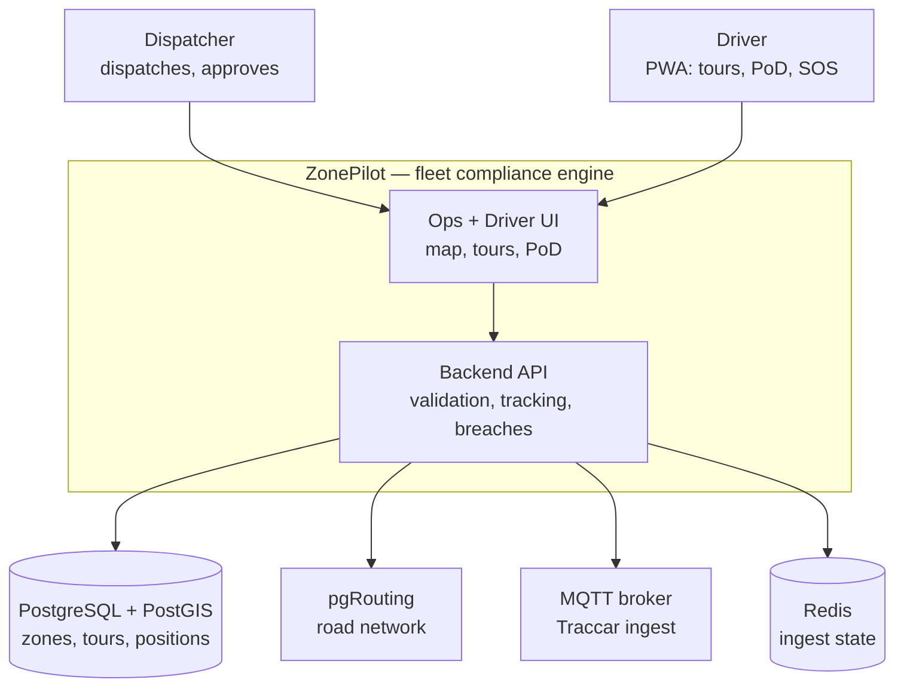
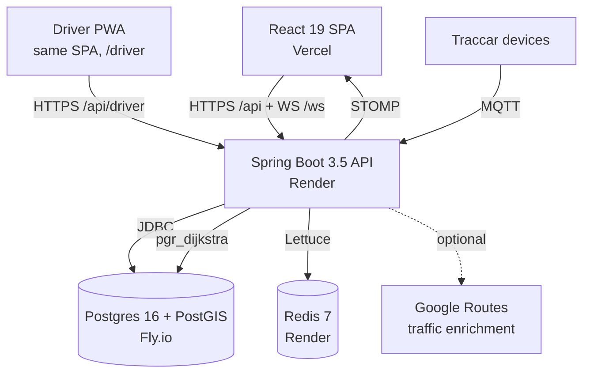
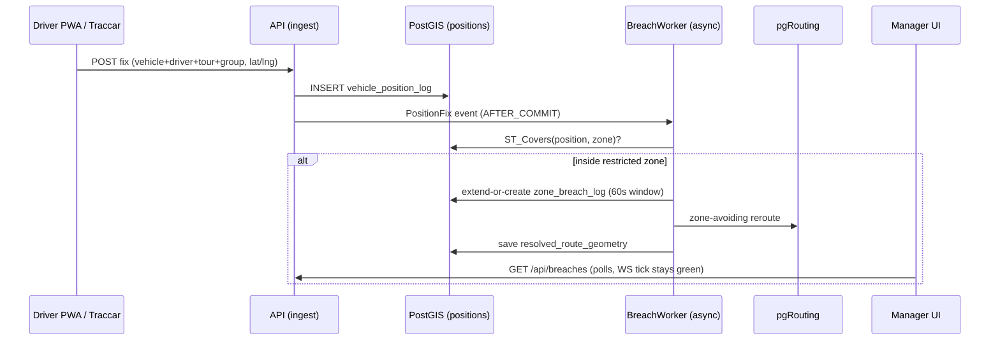
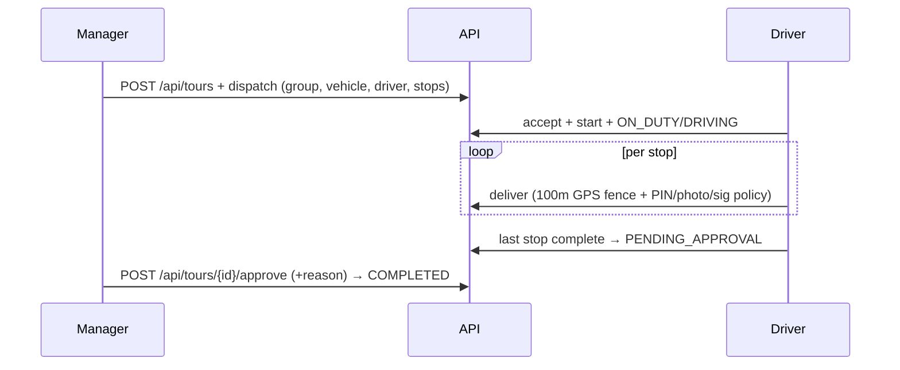
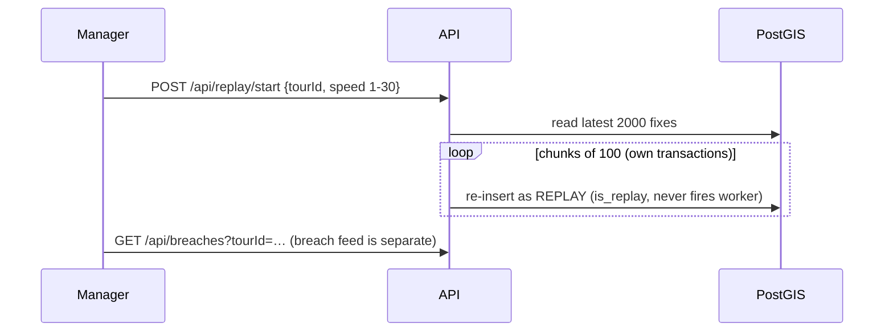
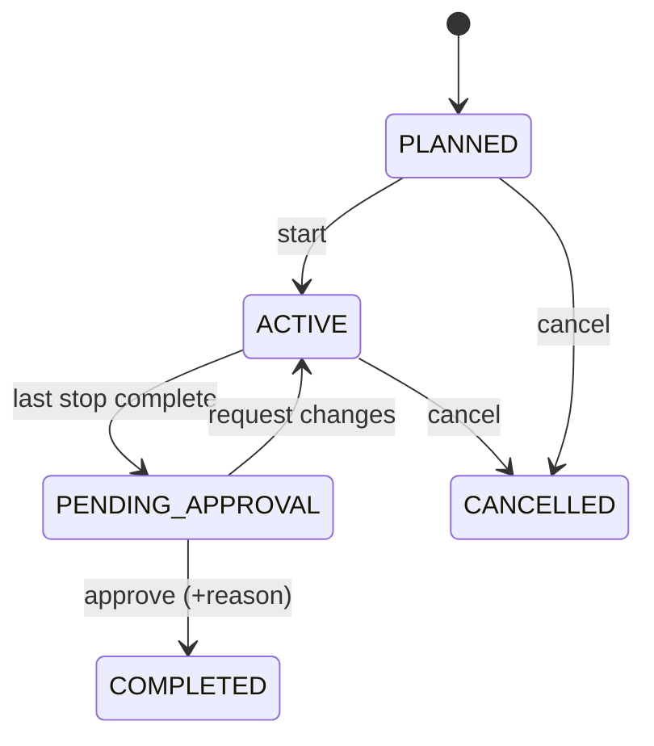
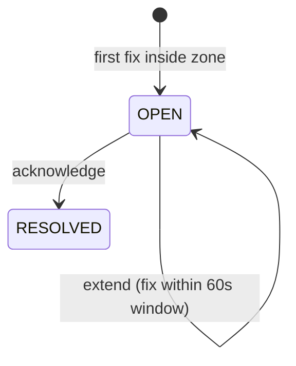
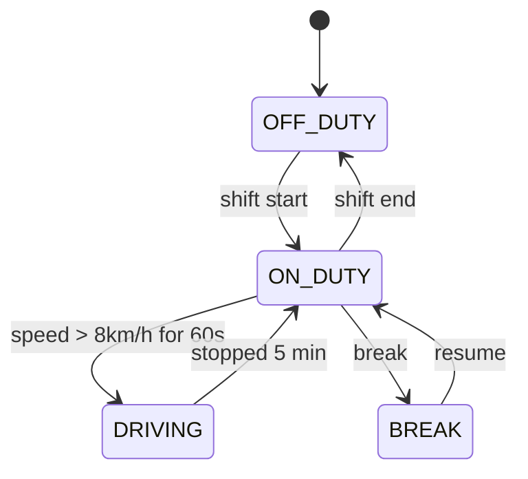
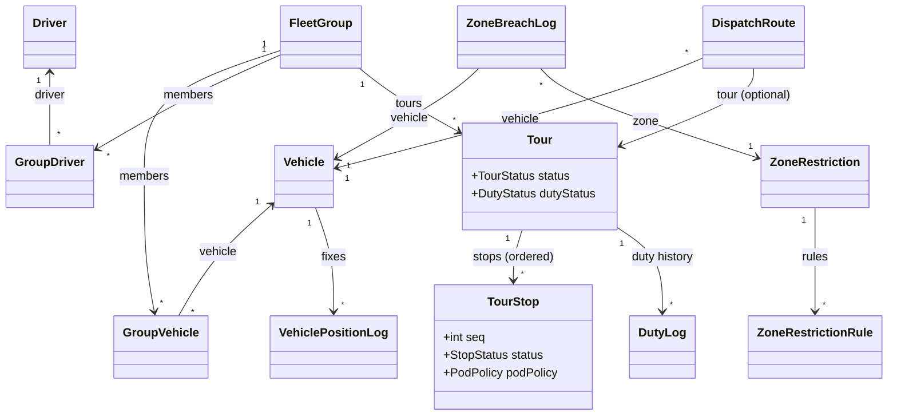
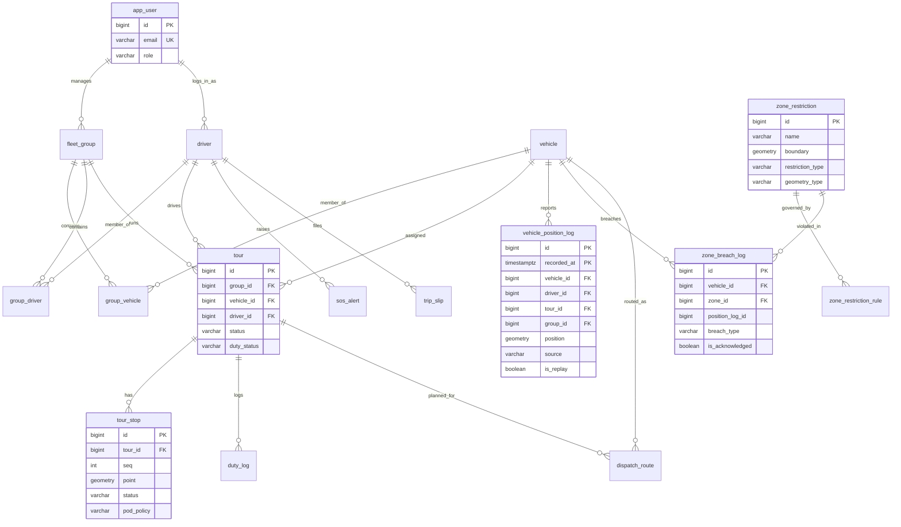

# ZonePilot Architecture

> How the system fits together: context, containers, key flows, domain model, and data model.
> Plain-language first; every diagram below renders natively on GitHub (flowchart/sequence/class/state/ER only — no C4 plugin blocks, no forced theme).

## 1. System context (C4 Level 1)

## 2. Containers (C4 Level 2)

## 3. Core flows

### 3.1 Live position → breach → reroute

### 3.2 Tour lifecycle: dispatch → PoD → approve

### 3.3 Replay (accelerated verification)

## 4. State machines

### 4.1 Tour

### 4.2 Breach

### 4.3 Duty (ELD hybrid: auto-suggest + manual confirm)

## 5. Domain model (core classes)

## 6. Data model (Postgres ER, core tables)

Loose `Long` foreign keys (`dispatch_route_attempt`, `load_event`, breach `position_log_id`) are enforced in service code, not by the database — shown dashed in reviews; only real FKs appear below.

Full column detail lives in `backend/src/main/resources/db/migration/` (V1–V53); this diagram shows the relations that matter for reviews.
