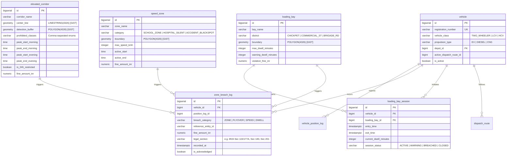
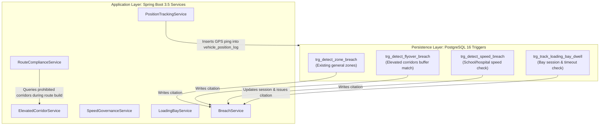

# ZonePilot — Real-World Compliance & Engine Evolution Specification

> **Branch:** `feature/real-world-compliance-mda`  
> **Author:** Antigravity & Lead Engineering  
> **Status:** Draft for Iterative Review  
> **Scope:** Bengaluru Municipal Compliance, Real-World Empirical Datasets, Modular Subsystems, and Operations Workspace  

---

## 1. Executive Summary & Objective

The objective of this specification is to transform **ZonePilot** from an academic prototype with 5 synthetic polygon zones into an enterprise-grade **Urban Fleet Spatial Compliance Engine** grounded in genuine, verifiable Bengaluru Traffic Police (BTP) regulations and empirical municipal data.

### Core Problems Being Solved:
1. **Absence of Real Regulatory Grounding:** Real traffic police in Bengaluru do not enforce arbitrary square polygons; they enforce **Elevated Flyover Bans**, **Peak-Hour Freight Curfews**, **School Zone Speed Caps**, and **Market Loading/Unloading Bay Limits**.
2. **One-Size-Fits-All Logic:** Previously, all vehicles were treated identically regardless of clean-energy status (diesel trucks vs. electric cargo three-wheelers).
3. **Cluttered Frontend Operations:** The interface previously presented a confusing collection of floating layers and drawers rather than a streamlined 3-zone operations console tailored for a commercial fleet dispatcher.

---

## 2. Real-World Regulatory & Empirical Data Sources

Every feature and dataset introduced in this specification is derived from official gazette notifications, government policies, empirical municipal surveys, or OpenStreetMap (OSM) spatial geometry.

### 2.1 Elevated Corridors & Flyovers

#### Regulatory Grounding:
- **Issuing Authority:** Bengaluru City Traffic Police (BTP), Office of the Commissioner of Police.
- **Official Notification Dates:** August 30, 2026; phased implementation orders effective September 4, 2026 and September 11, 2026.
- **Legal Enforcement Basis:** Section 115 (Power to restrict the use of vehicles) read with Section 177A of the Motor Vehicles Act (MVA) 1988 / 2019 Amendment.
- **Fine Structure:** ₹1,000 for 1st violation; ₹2,000 for subsequent violations.

#### Verified Corridors & Rules:

| Corridor Name | Extent & Geography | BTP Restriction Rule | Prohibited Classes | Active Window | Penalty |
|---|---|---|---|---|---|
| **Electronic City Elevated Expressway** | Silk Board (`12.9177°N, 77.6238°E`) to Electronic City Phase 1 (`12.8450°N, 77.6740°E`) ~9.98 km | Strict prohibition on all commercial goods vehicles to prevent breakdowns and heavy traffic blockages. | Heavy Commercial Vehicles (HCV), Medium Commercial Vehicles (MCV), Light Commercial Vehicles (LCV), 3-Wheeler Goods Autos | **06:00 to 22:00** (Goods vehicles); **24 Hours** (3-wheelers) | ₹1,000 (Sec 115/177A) |
| **Peenya Elevated Expressway (Tollway)** | Gorguntepalya (`13.0285°N, 77.5405°E`) to Nelamangala border (`13.0642°N, 77.4891°E`) ~4.2 km | Peak-hour ban on heavy commercial trucks to protect expansion joints and ease commuter congestion. | Heavy Commercial Vehicles (HCV), 3-Wheeler Goods Autos | **07:00 to 11:00** and **16:00 to 22:00** (Goods); **24 Hours** (3-wheelers) | ₹1,000 (Sec 115/177A) |
| **Double-Decker Flyover (Ragigudda – Silk Board)** | Ragigudda Temple (`12.9161°N, 77.5912°E`) to Central Silk Board (`12.9177°N, 77.6238°E`) ~5.1 km | Shared metro/road elevated corridor restricted to light non-commercial vehicles. | Heavy Commercial Vehicles (HCV), 3-Wheeler Goods Autos | **24 Hours** | ₹1,000 (Sec 115/177A) |
| **Kempegowda Airport Road Elevated Corridor** | Sanjay Nagar Cross (`13.0336°N, 77.5898°E`) to Hebbal Flyover (`13.0450°N, 77.5925°E`) | Elevated fast-track restricted for slow-moving freight. | Slow-moving commercial freight, 3-Wheelers | **24 Hours** | ₹1,000 (Sec 115/177A) |
| **Sirsi Circle (BGS) Flyover** | Sirsi Circle (`12.9554°N, 77.5621°E`) to City Market (`12.9642°N, 77.5755°E`) ~2.6 km | Elevated corridor built over congested market areas with strict vehicle weight caps. | Heavy Commercial Vehicles (HCV) | **24 Hours** | ₹1,000 (Sec 115/177A) |

#### Spatial Geometry Extraction:
- **Source:** OpenStreetMap Karnataka export (`karnataka-latest.osm.pbf`) clipped to Bengaluru bounding box.
- **Filter Tags:** `highway IN ('motorway', 'trunk', 'primary') AND bridge = 'yes' AND layer >= '1'`.
- **Representation:** PostGIS `LINESTRING(4326)` buffered with 15-meter corridor envelope for trigger detection.

---

### 2.2 Sensitive Area Speed Governance

#### Regulatory Grounding:
- **Issuing Standards:** Indian Roads Congress (IRC:99-2018: *Guidelines on Traffic Calming Measures in Urban Areas and Near Schools*).
- **Enforcement Body:** BTP Intelligent Traffic Management System (ITMS) using automated AI contactless radar cameras.
- **Legal Enforcement Basis:** Section 183 of the Motor Vehicles Act 1988 (Driving at excessive speed).
- **Fine Structure:**
  - Light Commercial Vehicles (LCV): ₹1,000.
  - Medium & Heavy Commercial Vehicles (MCV/HCV): ₹2,000.

#### Verified Spatial Speed Zones:

| Zone Name | Anchor Landmark & Coordinates | Regulated Radius / Envelope | Max Permissible Speed | Active Hours | Rationale & Enforcement |
|---|---|---|---|---|---|
| **Bishop Cotton School Zone** | St. Mark’s Road / Residency Road (`12.9716°N, 77.6012°E`) | 250m geofenced polygon along school perimeter | **25 km/h** | Mon–Fri: **07:30 to 16:30** | High pedestrian child density; ITMS camera actively enforced. |
| **Sophia High School / Mount Carmel Corridor** | Palace Road (`12.9912°N, 77.5891°E`) | 300m corridor along Palace Rd & Vasanth Nagar | **25 km/h** | Mon–Fri: **07:30 to 16:30** | Narrow arterial road with heavy student drop-off activity. |
| **Victoria & Vani Vilas Hospital Silent Corridor** | Fort Area, KR Market (`12.9625°N, 77.5742°E`) | 400m perimeter encompassing medical campus | **30 km/h** (Strict No-Honking) | **24 Hours** | Medical emergency zone and patient recovery area. |
| **Hebbal Junction Blackspot** | Hebbal Flyover interchange (`13.0450°N, 77.5925°E`) | 200m circular buffer | **35 km/h** for freight | **24 Hours** | Official BTP high-fatality accident blackspot due to sharp turning radii. |

---

### 2.3 CBD Commercial Loading/Unloading Bay Dwell Limits

#### Regulatory Grounding:
- **Policy Document:** BBMP (Bruhat Bengaluru Mahanagara Palike) *Parking Policy 2.0 for Bengaluru* & BTP Freight Mobility Circular.
- **Legal Enforcement Basis:** Section 122 read with Section 177 / Section 201 of the Motor Vehicles Act (Leaving vehicle in dangerous position / causing traffic obstruction).
- **Fine Structure:** ₹500 penalty + ₹100/hour towing/obstruction fee.

#### Verified Commercial Delivery Bays:

| Commercial Market | Anchor Location & Coordinates | Maximum Permissible Dwell Time | Peak Curfew Window (No Loading Allowed) | Warning Threshold | Fine |
|---|---|---|---|---|---|
| **Chickpet Wholesale Market & Avenue Road** | Old City Core (`12.9698°N, 77.5772°E`) | **20 Minutes** | **09:00 to 11:00** and **18:00 to 20:00** | 15 Minutes (Amber Alert) | ₹1,500 (Sec 201) |
| **Commercial Street Retail District** | Tasker Town (`12.9822°N, 77.6111°E`) | **25 Minutes** | **11:00 to 14:00** and **17:00 to 21:00** | 20 Minutes (Amber Alert) | ₹1,500 (Sec 201) |
| **Brigade Road & MG Road Freight Bay** | Central Business District (`12.9738°N, 77.6075°E`) | **15 Minutes** | **08:30 to 11:30** and **16:30 to 20:30** | 10 Minutes (Amber Alert) | ₹1,500 (Sec 201) |

---

### 2.4 Clean Air & EV Green Corridors

#### Regulatory Grounding:
- **Policy Framework:** *Karnataka Electric Vehicle and Energy Storage Policy* & Ministry of Road Transport and Highways (MoRTH) Notification GSR 525(E) (Statutory recognition of green registration number plates for zero-emission commercial transport).
- **Municipal Incentive:** In central Bengaluru air pollution abatement zones, electric commercial vehicles are granted **unrestricted 24/7 delivery access**, exempting them from daytime freight bans that apply to diesel and internal combustion engine (ICE) trucks.

#### Propulsion Classification:

| Propulsion Type | Code | Eligible Commercial Vehicles | Curfew Exemption Status | Green Corridor Privileges |
|---|---|---|---|---|
| **Electric Commercial Vehicle** | `EV` | Tata Ace EV, Euler HiLoad EV, Mahindra Zor Grand | **Exempt** from 07:00–11:00 & 16:00–22:00 diesel bans | Full 24/7 access to central delivery hubs |
| **Diesel Internal Combustion** | `DIESEL` | Tata 407, Ashok Leyland Dost Diesel, Eicher Pro, BharatBenz | **Strictly Subject** to peak curfews & elevated bans | Rerouted around CBD or placed in wait-state |
| **Compressed Natural Gas** | `CNG` | Tata Ace Gold CNG, Eicher Pro CNG | Standard freight regulations apply | Standard routing |

---

## 3. Database Schema & Migration Specification

To maintain a clean separation of concerns, we implement **dedicated modular subsystems** rather than overloading the existing generic `zone_restriction` table.



### 3.1 Migration Scripts Overview

- **`V21__create_elevated_corridor_subsystem.sql`:**
  - Creates `elevated_corridor` table with spatial GiST indexes on `center_line` and `detection_buffer`.
  - Seeds official coordinates for Electronic City, Peenya, Double-Decker, Airport Road, and Sirsi Circle corridors.
- **`V22__create_speed_governance_subsystem.sql`:**
  - Creates `speed_zone` table with spatial GiST index on `boundary`.
  - Seeds Bishop Cotton, Sophia High, Victoria Hospital, and Hebbal Blackspot polygons.
- **`V23__create_loading_bay_subsystem.sql`:**
  - Creates `loading_bay` and `loading_bay_session` tables.
  - Seeds Chickpet, Commercial Street, and Brigade Road delivery bays.
- **`V24__evolve_vehicle_and_breach_schema.sql`:**
  - Adds `propulsion_type VARCHAR(20) DEFAULT 'DIESEL' NOT NULL` to `vehicle`.
  - Seeds representative EV vehicles (`KA01-EV-0010`, `KA01-EV-0011` as `LCV` with propulsion `EV`).
  - Extends `zone_breach_log` with `breach_category`, `legal_section`, and `fine_amount_inr`.

---

## 4. Backend Services & Spatial Trigger Implementation



### Spatial Trigger Details:
1. **Flyover Breach Trigger (`trg_detect_flyover_breach`):**
   - Matches incoming coordinate against `ST_Intersects(ec.detection_buffer, NEW.position)`.
   - Compares vehicle class, propulsion, and server time in `Asia/Kolkata` against restriction windows.
2. **Speed Breach Trigger (`trg_detect_speed_breach`):**
   - Checks `ST_Within(NEW.position, sz.boundary)`.
   - If `NEW.speed_kmh > sz.max_speed_kmh` and current time is within school hours, writes `SPEED_VIOLATION` breach with legal citation `MVA Sec 183`.
3. **Loading Bay Dwell Trigger (`trg_track_loading_bay_dwell`):**
   - Detects vehicle entry into loading bay geofence.
   - Computes elapsed dwell time on subsequent pings.
   - Emits `WARNING` at 15 minutes; writes `LOADING_BAY_OVERTIME` breach (₹1,500 citation) at 20 minutes.

---

## 5. 4 Showstopper Real-World Simulation Scenarios

```mermaid
sequenceDiagram
    autonumber
    actor Dispatcher as 👤 Dispatcher Console
    participant Sim as SimulationService
    participant Engine as ZonePilot Compliance Engine
    participant Map as 🗺 Operations Map

    Note over Dispatcher,Map: Scenario 1: Diesel HCV Flyover Diversion
    Dispatcher->>Sim: Launch Scenario 1 (KA01-HCV-0007: Silk Board -> E-City Phase 1)
    Sim->>Engine: Validate route at 09:30 AM (Peak Window)
    Engine->>Engine: Detect E-City Flyover restriction for Diesel HCV (06:00-22:00)
    Engine-->>Sim: Compute diversion via Hosur Road surface highway
    Sim->>Map: Render diverted route (Avoids elevated flyover, 0 fines)

    Note over Dispatcher,Map: Scenario 2: Tata Ace EV Green Corridor Transit
    Dispatcher->>Sim: Launch Scenario 2 (KA01-EV-0010: Indiranagar -> Majestic CBD)
    Sim->>Engine: Validate route at 08:30 AM (Peak Diesel Curfew)
    Engine->>Engine: Recognize propulsion_type = EV; Apply Green Corridor exemption
    Engine-->>Sim: Return direct central corridor route (Approved 24/7)
    Sim->>Map: Render green corridor transit path

    Note over Dispatcher,Map: Scenario 3: Delivery Van Speeding in School Zone
    Dispatcher->>Sim: Launch Scenario 3 (KA01-LCV-0004 traversing Residency Road)
    Sim->>Engine: Ingest telemetry: Lat/Lng inside Bishop Cotton School, Speed = 46 km/h
    Engine->>Engine: Trigger fires: 46 km/h > 25 km/h cap (active 07:30-16:30)
    Engine-->>Dispatcher: Instant Speed Breach Alert: ₹1,000 citation under MVA Sec 183
    Sim->>Map: Highlight school zone in pulsing amber with speed badge

    Note over Dispatcher,Map: Scenario 4: Chickpet Loading Bay Overtime
    Dispatcher->>Sim: Launch Scenario 4 (KA01-LCV-0005 parked at Chickpet Bay)
    Sim->>Engine: Ticks 1-15: Dwell = 15m -> Emit Amber Dwell Warning
    Sim->>Engine: Ticks 16-20: Dwell = 22m -> Exceeded 20m threshold
    Engine-->>Dispatcher: Critical Breach: Loading Bay Overtime fine ₹1,500 (MVA Sec 201)
    Sim->>Map: Bay marker turns red; citation logged to audit ledger
```

---

## 6. Frontend Operations Workspace Redesign

### UI Architecture: The 3-Zone Control Layout

```
+-------------------------------------------------------------------------------------------------------+
|  🛡 ZONEPILOT OPERATIONS CONTROL ROOM               [Live IST: 09:42 AM]   [Active Vehicles: 14]       |
+--------------------------+--------------------------------------------------+-------------------------+
| ZONE 1: FLEET & ALERTS   | ZONE 2: SPATIAL OPERATIONS CANVAS               | ZONE 3: DISPATCH DRAWER |
|                          |                                                  |                         |
| 🔍 Filter Vehicles...    | [Layer Toggles: Flyovers | Speed | Bays | Live]  | 🚚 DISPATCH PLANNER     |
|                          |                                                  | Origin: Yeshwantpur     |
| [FLEET LIST]             | • Electronic City Elevated (Purple Line)        | Dest: E-City Phase 1    |
| • KA01-HCV-0007 [HCV]    | • Bishop Cotton School Zone (Amber Box 25km/h)   | Vehicle: KA01-HCV-0007  |
|   Status: Surface Detour | • Chickpet Commercial Bay (Cyan Polygon)         | Class: Diesel HCV       |
| • KA01-EV-0010  [EV]     | • Vehicle Marker (Green Arrow, 34 km/h)          | [COMPUTE COMPLIANCE]    |
|   Status: Green Corridor | • Diverted Route Line (Emerald Polyline)         |                         |
| • KA01-LCV-0004 [LCV]    |                                                  | Result:                 |
|   Status: At Chickpet Bay|                                                  | ⚠ Flyover Ban Detected  |
|                          |                                                  | ✔ Surface Detour Built  |
| [CRITICAL AUDIT ALERTS]  |                                                  |                         |
| ⚠ OVERTIME: Chickpet Bay |                                                  | 📊 TELEMETRY STREAM     |
|   KA01-LCV-0005 (+2m)    |                                                  | Lat: 12.8491, Lng: 77.67|
| ⚠ SPEED: Bishop Cotton   |                                                  | Speed: 32 km/h          |
|   KA01-LCV-0004 (46km/h) |                                                  | Heading: 174°           |
+--------------------------+--------------------------------------------------+-------------------------+
| BOTTOM BAR: SCENARIO PLAYER [▶ Scenario 1: Flyover] [▶ Scenario 2: EV] [▶ Scenario 3: Speed] [▶ Bay]  |
+-------------------------------------------------------------------------------------------------------+
```

### Key UX Improvements:
1. **Zero Clutter:** Eliminates arbitrary modal popups in favor of clear, docked sidebars that preserve map visibility.
2. **Context-Sensitive Colors:**
   - **Purple:** Elevated Corridors & Flyovers.
   - **Amber:** Sensitive Speed Zones (Schools & Hospitals).
   - **Cyan:** CBD Loading/Unloading Bays.
   - **Emerald:** Validated Compliant Route.
   - **Red:** Active Breach or Detour Trigger.
3. **One-Click Scenario Player:** A fixed bottom control bar allows evaluators and dispatchers to trigger any of the 4 real-world scenarios with a single click, observing live map animation, trigger execution, and breach resolution in real time.

---

## 7. Implementation Roadmap & Phasing

| Phase | Milestone | Deliverables | Verification Criteria |
|---|---|---|---|
| **Phase 1** *(Completed)* | Architecture & Specs | • MDA Specifications (`docs/architecture/`)<br>• Real-world Update Spec (`docs/UPDATE_SPEC_REAL_WORLD_COMPLIANCE.md`)<br>• Executive README (`README.md`) | Visual models complete, empirical data sources cited. |
| **Phase 2.1** | Flyway DB Migrations | • `V21__elevated_corridors.sql`<br>• `V22__speed_zones.sql`<br>• `V23__loading_bays.sql`<br>• `V24__vehicle_propulsion_and_breaches.sql` | `mvn flyway:migrate` succeeds; all PostGIS spatial indexes and test seeds present. |
| **Phase 2.2** | Backend Services & Triggers | • `ElevatedCorridorService`, `SpeedGovernanceService`, `LoadingBayService`<br>• PostgreSQL triggers `trg_detect_flyover_breach`, etc.<br>• REST controllers & Swagger DTOs | Unit & integration tests pass; triggers fire upon simulated position insertion. |
| **Phase 2.3** | Simulation Seeding | • Updated `SimulationDataSeeder` with the 4 showstopper real-world scenarios | `/api/simulation/start` executes all 4 scenarios end-to-end. |
| **Phase 3** | Frontend Operations Workspace | • 3-Zone Workspace layout (`Dashboard.jsx`)<br>• Flyover, Speed Zone & Loading Bay map layers<br>• One-click Scenario Player bar | UI displays clear live status, responsive drawers, and animated real-time compliance events. |
