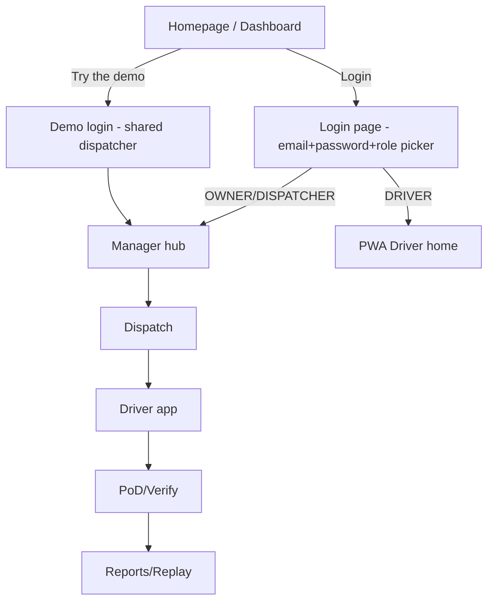
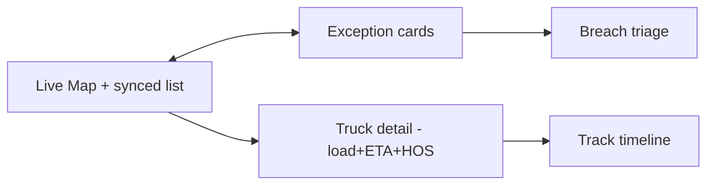
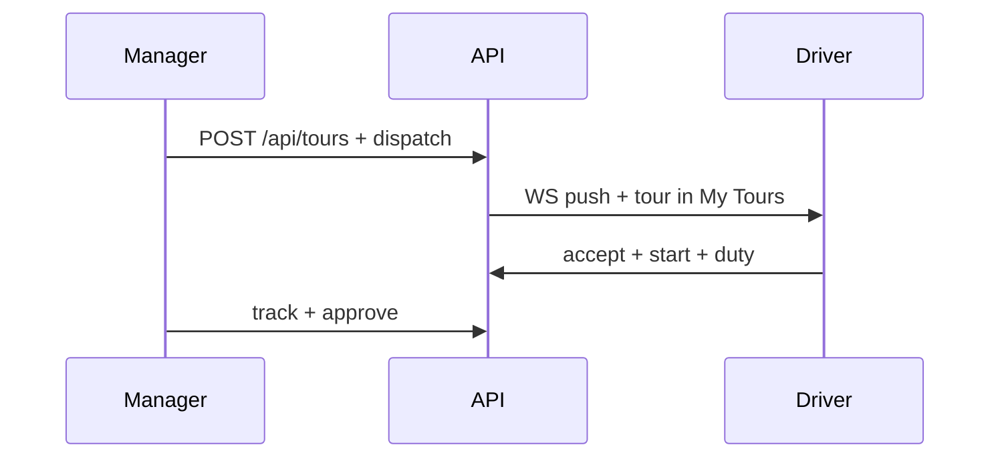

# ZonePilot — User Flows & UX Blueprint (frontend build spec)

STATUS: final — Markdown + Mermaid, for frontend overhaul.

## 0. How to try the demo (homepage → both logins)

Homepage `/` = Dashboard ops hub (Motive Fleet-View pattern: live map center + synced list, KPI hero + context + drill-down).

**Try-demo (no signup):** banner `You're in demo mode — shared read-only data, resets daily` + button `Try the demo` → one-click login as demo dispatcher (no password typing). Demo data coherent: 8 vehicles, 4 zones, 7 positions, 5 breaches, 2 restrictions. Include one unflattering state (1 overdue breach, 1 failed PoD). Edits in demo: read-only or per-session reset. One visible route demo → real account (`Create workspace` carries group filter).

**Sample logins (test fixtures, no seed users in migrations — bootstrap = first `POST /api/auth/register` → OWNER):**
- Owner: `owner@zonepilot.io / owner-pass-1` (sees all groups)
- Dispatcher: `disp@hsr.test / disp-pass-1` (own groups only)
- Driver: register via `POST /api/drivers` then login (owns no groups, `requireOwnedTour` gates tours)
- Manager UI has no login page today — paste JWT from Swagger `Authorize` (fix in overhaul: add `/login` for manager/dispatcher + role picker cards).

## 1. Home (Manager hub) — show / how

Show: KPI hero (Active tours, Breaches today, On-time %, Vehicles IN_TRANSIT) + Live Map (zones purple/red, trucks green/red, corridor bands) + Exception Alerts (clickable counts → filtered Breaches) + Activity feed + Group filter + Fullscreen TV mode.
How: `GET /api/groups`, `GET /api/vehicles?isActive`, `GET /api/vehicles/{id}/positions/latest` fan-out, `GET /api/zones/active`, `GET /api/breaches?unacknowledged=true`, `GET /api/reports/active-restrictions`, WS `/topic/group/{id}` + backfill `GET /api/groups/{id}/ticks?since&limit`. Empty: `No unassigned tours — Create dispatch`. Stale GPS: dotted trail + `data unavailable`.

## 2. Dispatch (Groups → Tours)

Flow: Morning Day-view (Unassigned top, crews below) → bulk select → Assign (vehicle free + driver licensed + docs + hours + maintenance guardrails, `assign anyway` override with reason) → Dispatch (push to driver app + WS) → Follow live → Close day (waiting/tolls/receipts → approve → invoice).
Show: Day/Board/Timeline/Map views, capacity free-vehicles/day, drag tour→truck, conflict modal, dispatch history.
API: `POST /api/groups`, `POST /api/groups/{id}/dispatch {vehicleId,driverId,origin...}`, `POST /api/groups/dispatch-solo`, `POST /api/tours {group,vehicle,driver,stops,manifest}`, `GET /api/tours/{id}/track`.

## 3. Driver PWA (`/driver`)

Flow: Invite → Route Assigned (push) → Preview (map+list, counts, distance) → Start (allow Always GPS) → loop per stop: Navigate → Arrive → View details → Scan/PIN → Complete (Delivered/Failed/Re-attempt/Partial) → End route → Green confirmation + `Navigate to next`.
Show: big one-tap buttons, offline banner + `sync pending N`, stop cards, duty bar (OFF/SB/D/ON + YM/PC), SOS one-tap, HOS clocks, photo/sig/PIN gates (centrally configured, PIN never on phone), ≤2 photos, signature-skip only with photo → contactless flag.
API: `POST /api/auth/login`, `GET /api/driver/tours`, `POST .../accept|start`, `POST .../duty {status}`, `POST .../stops/{seq}/complete {lat,lng}`, `.../skip {reason}`, `POST /api/driver/sos {lat,lng,routeId}`, offline queue `opId` idempotent, server-wins conflicts.
Empty: `No tours assigned`. Offline: keep working cached route, true timestamps, auto-sync on reconnect.

## 4. Breach triage + approve timeline

Flow: Alarm digest (counts/type) → click → filtered Breaches → grouped incident timeline → gates: false positive? close+tune / playbook? execute / escalate? (reason+time+checks) → auto-approve low-risk, SLA escalate 15min→2hr→4hr.
Show: Maersk timeline (completed filled / current highlighted / pending dashed, badges not color-only, `By actor | Ref`, planned vs actual, collapsed desc + Show details), Approve-as-X / Request-changes / Undo, SLA clock bar, audit record (who/when/reason/cost/device+IP).
API: `GET /api/breaches?vehicleId&zoneId&tourId&groupId&unacknowledged`, `GET /api/breaches/{id}`, `PUT .../acknowledge`, `GET /api/tours/{id}/track`, `POST /api/tours/{id}/approve`.

## 5. Replay + Reports

Replay: Trips History → select trip → Show replay → playback bar (play from stop, 1-30x + event-skip), triangle driving / square stop, dotted gap hover, speed-colored route, violation markers, keep-in-view + snap-to-road toggles, per-tour breach feed (not vehicle-only).
API: `POST /api/replay/start {tourId,speed}`, `GET /api/tours/{id}/track`, breach feed filtered by tour+window.

Reports: hero KPI + context + drill-down, 4 tabs (Overview/Fuel/Driver/Maintenance), presets Today/7/30/90 + custom, one-click CSV/PDF, role-scoped cards.
API: `GET /api/reports/summary`, `/zones/{id}/violations`, `/active-restrictions`.

## 6. Zones + Vehicles (setup pages)

Zones: list → draw polygon/corridor/circle → set type (NO_ENTRY/TIME/CLASS + corridor width, dwell threshold, direction BOTH/ENTRY/EXIT) → rules → save. Show boundary + active windows.
API: `GET/POST /api/zones`, `GET /api/zones/active`, `DELETE`, `GET /api/vehicles/{id}/zones-at-location?lat&lng`.

Vehicles: list → register → availability toggle → clear route. Show class, availability, active route.
API: `GET/POST /api/vehicles`, `POST /api/vehicles/{id}/availability`, `POST .../clear-route`.

## 7. Page inventory for overhaul (what to show / API)

| Page | Show | Key API |
|---|---|---|
| `/` Dashboard | KPIs, map, alerts, activity, group filter, TV | groups, vehicles, latest, zones/active, breaches?unack, reports, WS group |
| `/groups` | CRUD + members + dispatch + history | groups CRUD, add/remove, dispatch/solo, ticks backfill |
| `/routes` | validate + history + overlay | routes/validate, routes/{id}, vehicle history, delete |
| `/breaches` | triage + acknowledge | breaches list/get/ack (tour+group scoped) |
| `/reports` | KPIs + tabs + export | reports 3 endpoints |
| `/replay` | trip picker + player + breach feed | replay/start, tours/track, breaches tour-filtered |
| `/driver` | tours, duty, PoD, SOS, offline | driver/*, sos, HOS |
| `/vehicles` `/zones` | setup tables + draw | vehicles/zones CRUD |

Auth everywhere: `Authorization: Bearer <JWT>`; 401 → login; 403 → hide (don't gray).

## Sources (seed: 30+, 15 domains)
SearXNG + lanes: movethewheels control-tower, fsmnavigator dispatch-board, vau0 duty overlays, routectrl command-center, odro.ai Confirm-GPS, kivalogic offline-first, cooriroo PIN-server-side, alvys/fleetbase bulk dispatch, levyelectric SLA board, cargowiz/transitour drag-assign, Maersk timeline, shadcn approval block, geotab trip-replay 0.5-32x, Traccar geofences/events, FMCSA HOS, Intugine ULIP, TfL ULEZ, urbanaccessregulations.eu, FDA/WHO/UNECE cold-chain/hazmat, springdoc.org. Full URLs in `.omo/ulw-research/20261101-201128/` + `docs/ULW-RESEARCH-TRACKING-RULES.md`.
