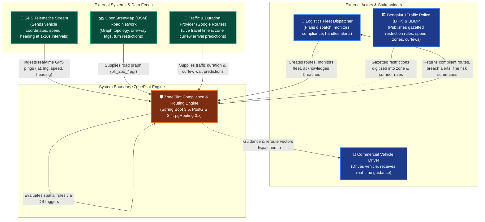
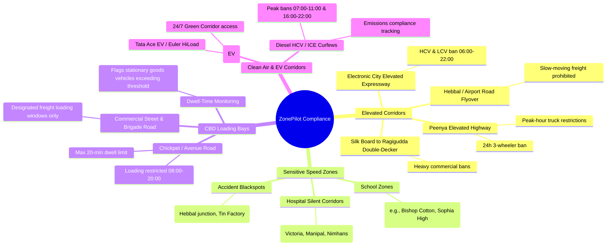

# 01. System Context Model

## 1. Domain Problem & System Boundary

In urban freight distribution across Bengaluru, logistics operations face strict and fragmented municipal regulations. Violating these regulations leads to immediate vehicle impoundment, fines exceeding ₹2,000–₹5,000 per incident, delayed customer deliveries, and damaged fleet reliability.

**ZonePilot** acts as an automated **Spatial Compliance Intelligence Engine** positioned between fleet telematics/dispatch systems and municipal road networks. It computes compliant routing, monitors live telemetry, detects breaches at the database trigger level, and provides automated rerouting recommendations.

---

## 2. C4 System Context Diagram (Level 1)

---

## 3. Real-World Bengaluru Compliance Scope

ZonePilot focuses on 4 real-world compliance dimensions grounded in Bengaluru municipal law:

---

## 4. Key Operational Constraints

1. **Sub-second Spatial Ingestion:** High-frequency GPS pings must be processed without backlog; triggers execute within the transactional boundary of the position insert.
2. **Deterministic Rerouting:** When a route is blocked by curfew or corridor restriction, the pgRouting engine must either penalize blocked segments (1000x cost) to discover clean detours or compute an optimal wait-state.
3. **No False Detours for Sensor Noise:** GPS pings drifting within 30m of the active route are snapped back to carriageway; off-route rerouting only triggers after 2 consecutive verified drift pings (>50m).
