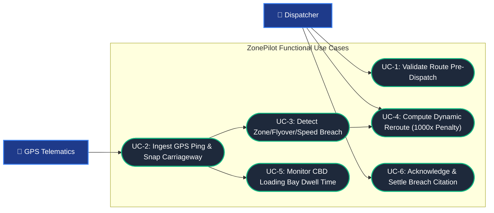
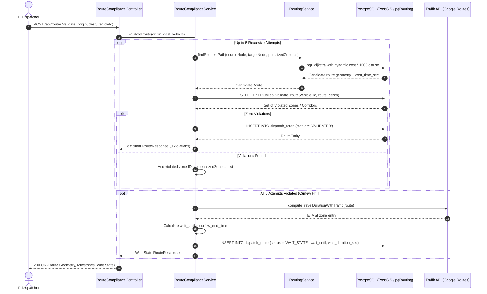
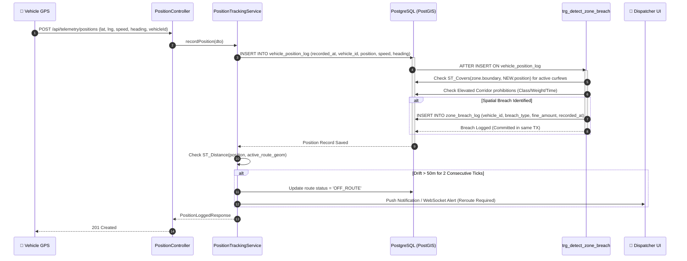
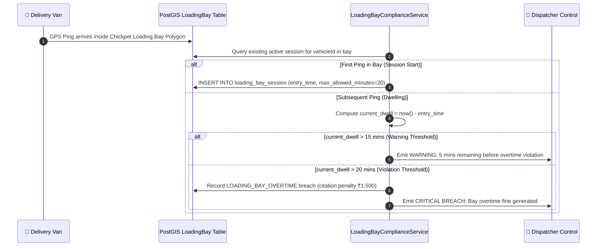
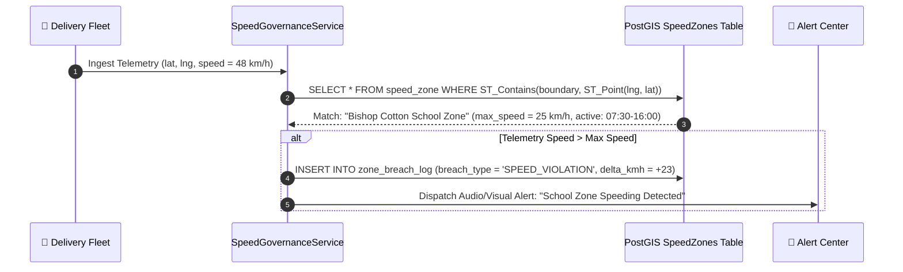

# 02. Interaction Model

## 1. Overview

The Interaction Model defines how external actors and internal system components exchange messages, coordinate business logic, and handle runtime spatial events.

---

## 2. Use Case Architecture

---

## 3. Sequence Diagrams

### 3.1 Pre-Dispatch Route Validation & Avoidance Pipeline

This sequence illustrates the recursive pgRouting loop: testing candidate paths against active restrictions, applying a 1,000x penalty to blocked segments, or falling back to a predictive wait-state.

---

### 3.2 In-Flight Telematics Stream & DB-Trigger Breach Ingestion

Breach detection is executed inside the transactional boundary of the position insert via PostgreSQL trigger `trg_detect_zone_breach`.

---

### 3.3 CBD Loading Bay Dwell-Time Tracking

Monitors commercial delivery stops in congested retail zones (e.g. Chickpet, Commercial St).

---

### 3.4 Sensitive Area Speed Governance Sequence

