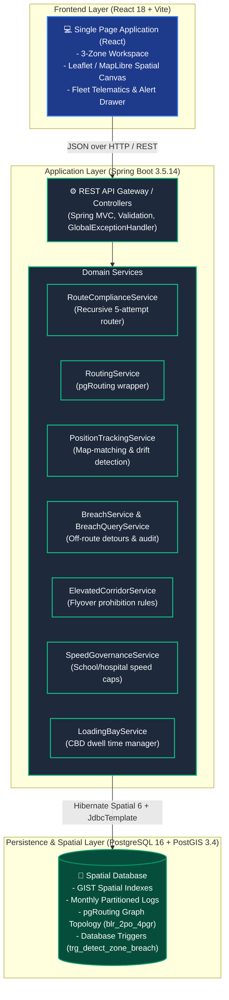
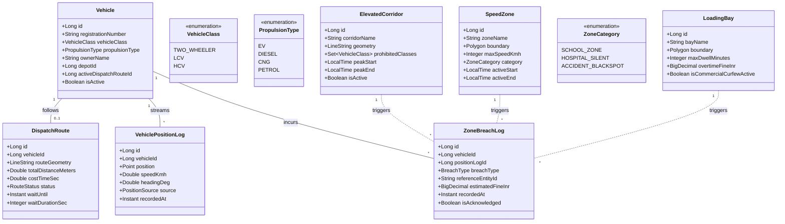
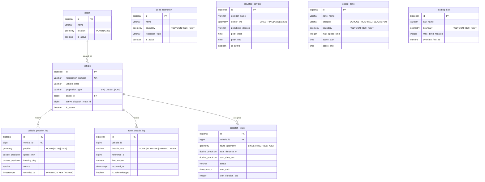

# 03. Structural Model

## 1. Overview & Architectural Style

ZonePilot follows a **Modular Domain-Centric Spatial Architecture**. The core spatial computation is offloaded to native PostGIS geometry operators and pgRouting graph algorithms to ensure microsecond-level spatial queries and trigger atomicity.

---

## 2. C4 Level 2: Container Diagram

---

## 3. Domain Class Diagram

---

## 4. PostGIS Spatial Database Schema & ERD

---

## 5. Partitioning & Spatial Indexing Strategy

1. **Monthly Range Partitioning:** `vehicle_position_log` is partitioned by `recorded_at` (`PARTITION BY RANGE (recorded_at)`) with a `DEFAULT` partition to prevent write degradation as telemetry millions accumulate.
2. **GiST Spatial Indexes:** High-speed bounding box intersection tests (`&&`) and distance calculations (`<->`, `ST_DWithin`, `ST_Covers`) are enabled via GiST indexes across `zone_restriction(boundary)`, `elevated_corridor(center_line)`, `speed_zone(boundary)`, and `loading_bay(boundary)`.
3. **Directed Road Network Graph:** `blr_2po_4pgr` stores the topology with pre-computed `cost_time_sec` and directed one-way indicators (`reverse_cost = -1`), queried via JDBC Template and `pgr_dijkstra`.
