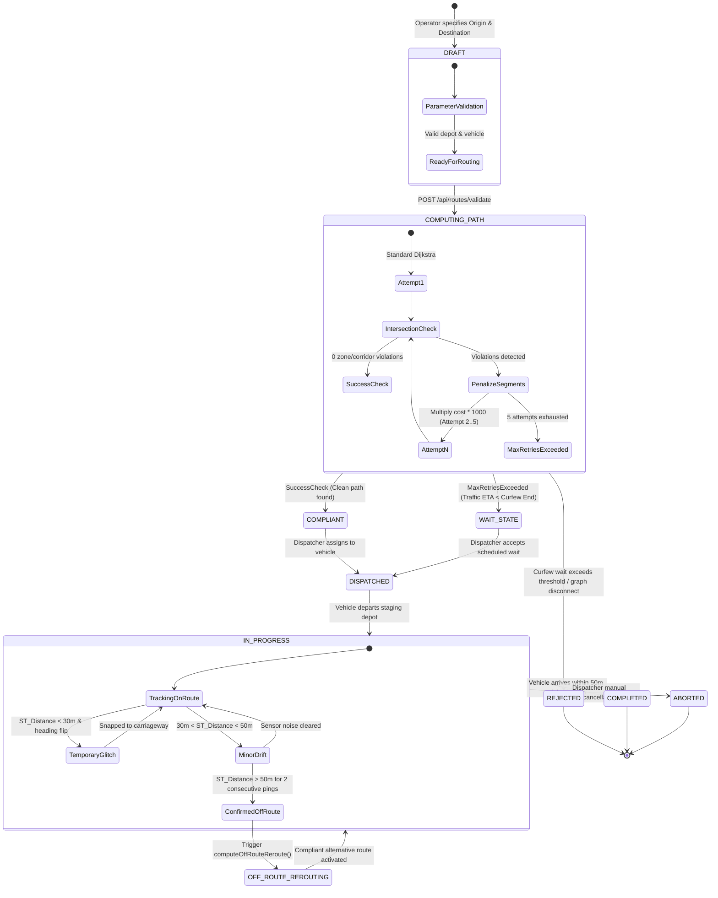
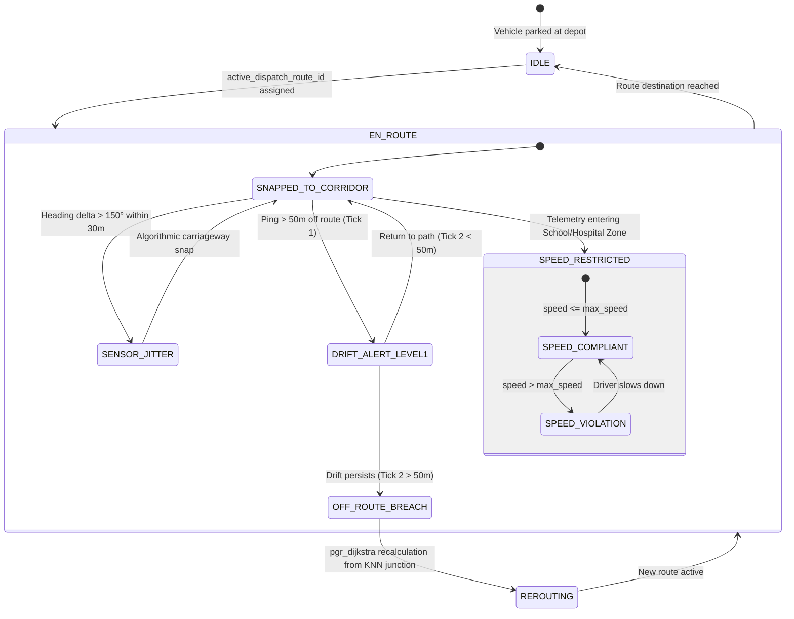
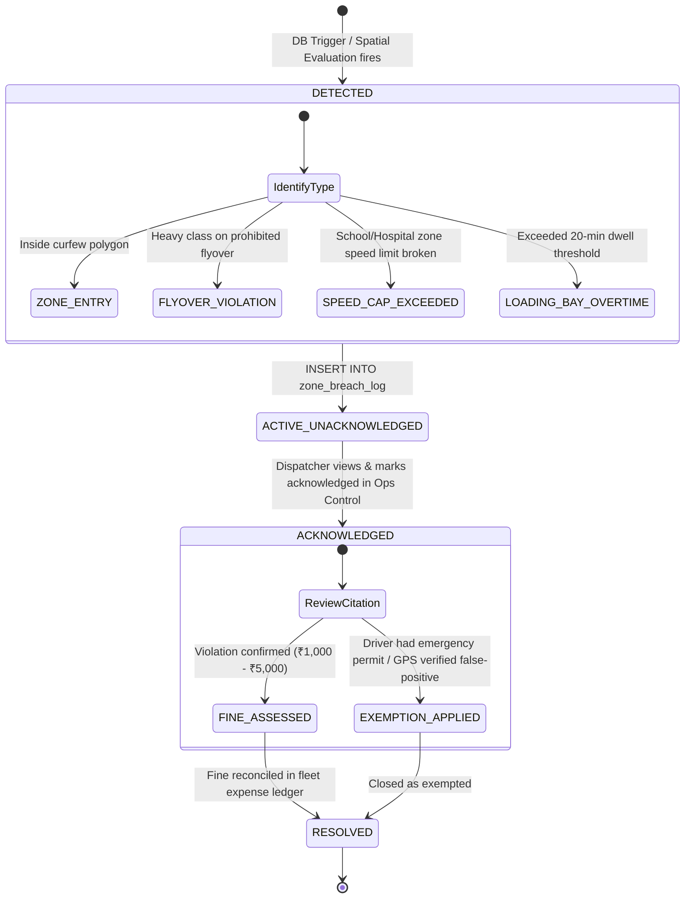
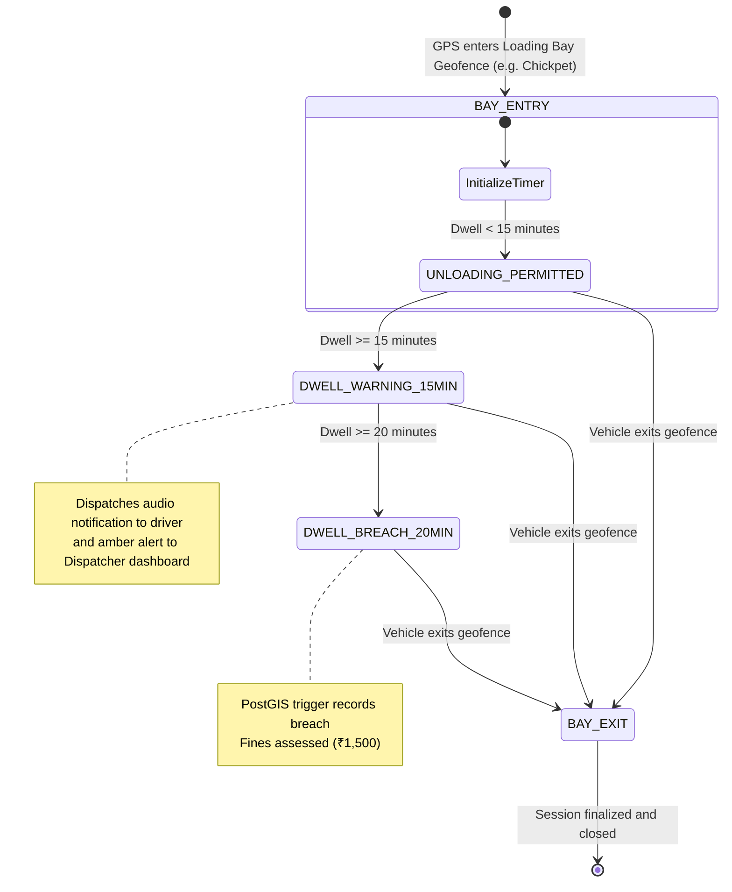

# 04. State Transition Model

## 1. Overview

The State Transition Model captures the dynamic behavior, runtime lifecycles, and discrete state evolutions triggered by spatial events across ZonePilot.

---

## 2. Dispatch Route Lifecycle Statechart

---

## 3. Vehicle Telematics Tracking Statechart

---

## 4. Compliance Breach Citation & Audit Statechart

---

## 5. CBD Loading Bay Dwell Statechart

