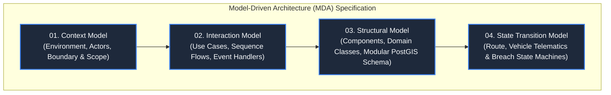

# ZonePilot — Model-Driven Architecture (MDA) Specification

> **System Name:** ZonePilot  
> **Tagline:** Urban Fleet Spatial Compliance & Dispatch Engine for Bengaluru  
> **Target Persona:** Logistics Fleet Dispatcher & Operations Control  
> **Architecture Standard:** Model-Driven Architecture (MDA) & C4 Model  

> Amendment 2026-11-01 (Wave C): these 01–04 files are early PSM sketches — "depot"/`depot_id` wording in them now reads "group"/`group_id` (`fleet_group`, STOMP `/topic/group/{id}`). The stable contract is `docs/10-PIM-PLATFORM-INDEPENDENT.md`; history kept in git.

---

## 1. Overview & Architectural Motivation

ZonePilot addresses the core operational challenge facing urban commercial fleets in Bengaluru: **navigating complex, dynamic, and multi-dimensional municipal traffic regulations without incurring fines, route delays, or delivery disruptions.**

To replace bloated documentation with clean, rigorous, and visually verifiable designs, this specification organizes ZonePilot's architecture into **four foundational architectural models**:

---

## 2. Directory Navigation

| Document | Purpose | Core Diagrams |
|---|---|---|
| [01_CONTEXT_MODEL.md](file:///home/shreyas/projects/ZonePilot/docs/architecture/01_CONTEXT_MODEL.md) | Defines system boundary, external actors, and the 4 real-world compliance dimensions. | C4 Level 1 Context Diagram, Domain Scope Matrix |
| [02_INTERACTION_MODEL.md](file:///home/shreyas/projects/ZonePilot/docs/architecture/02_INTERACTION_MODEL.md) | Details system workflows, API interactions, and telemetry event cascades. | Pre-dispatch Validation Sequence, In-flight Trigger Sequence, Dwell Time Timeout Sequence |
| [03_STRUCTURAL_MODEL.md](file:///home/shreyas/projects/ZonePilot/docs/architecture/03_STRUCTURAL_MODEL.md) | Maps modular subsystems, Spring Boot components, and PostGIS spatial schemas. | C4 Level 2 Container Diagram, Class Diagram, Spatial ERD |
| [04_STATE_TRANSITION_MODEL.md](file:///home/shreyas/projects/ZonePilot/docs/architecture/04_STATE_TRANSITION_MODEL.md) | Formally specifies operational lifecycles and trigger-driven state machines. | Route Lifecycle Statechart, Vehicle Drift Statechart, Breach Resolution Statechart |

---

## 3. The 4 Real-World Compliance Subsystems

ZonePilot moves beyond abstract geographic polygons by modeling genuine Bengaluru municipal and traffic police regulations:

1. **Elevated Corridor & Flyover Restrictions:** Enforcing vehicle class and weight prohibitions on high-risk flyovers (Peenya, Electronic City Elevated, Silk Board Double-Decker, Hebbal).
2. **Sensitive Area Speed Governance:** Monitoring vehicle telematics against speed caps near school zones, hospital silent corridors, and accident blackspots.
3. **CBD Loading/Unloading Bay Dwell Limits:** Tracking commercial parking dwell times in dense trade hubs (Chickpet, Commercial St, Brigade Rd) to prevent unloading violations.
4. **Clean Air & EV Green Corridors:** Granting zero-emission electric vehicles (Tata Ace EV, Euler) 24/7 access to central delivery zones while restricting diesel commercial vehicles during peak curfew windows.
